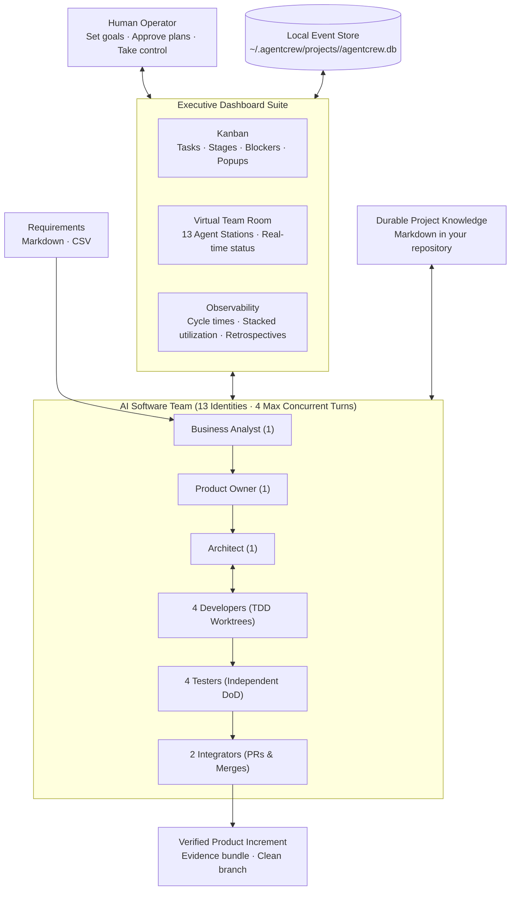
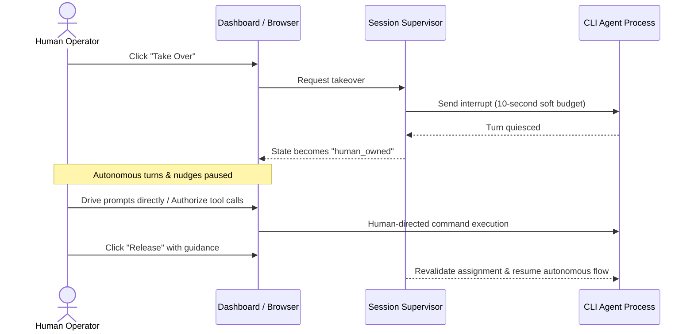

# agentcrew

**Your local AI software team, from requirements to verified delivery.**

agentcrew turns any Git repository into an autonomous AI Team Workspace where one operator directs 13 persistent agent identities across an iteration: plan, build with TDD, independently verify, integrate, track scope changes, and take the wheel in real-time.



---

## The Rule Everything Follows

**No mandatory agentcrew account or hosted cloud control plane. Your durable data remains in formats you own.**

- **Durable knowledge stays in your repository**: Tasks (`backlog/tasks/`), ADRs (`backlog/decisions/`), rules (`AGENTS.md`), memory (`docs/memory/`), and requirements live in plain, version-controlled Markdown.
- **Execution state stays local**: Transcripts, normalized event streams, and process states live in your local SQLite store (`~/.agentcrew/projects/<id>/agentcrew.db`).
- **Official CLI binaries**: Connects directly to your installed `agy`, `Codex`, and `Gemini` tools without reverse-engineered proxies or credential leaking.

---

## Prerequisites

- **Node.js**: Node.js ≥ 22 (recommended Node 24 for built-in `node:sqlite`)
- **Git**: Installed and accessible in PATH
- **Agent CLIs** (at least one installed):
  - [Antigravity CLI (`agy`)](https://github.com)
  - [OpenAI Codex (`codex`)](https://github.com)
  - [Gemini CLI (`gemini`)](https://github.com)
- **OS**: Linux, macOS, or Windows

---

## Quickstart

### 1. Onboard a Repository

From inside the Git repository you want to turn into an AI Team Workspace:

```bash
# Quick run without global installation
npx github:inegmdev/agentcrew setup .
```

Or install globally:

```bash
npm install -g github:inegmdev/agentcrew
agentcrew setup .
```

`setup` performs the following steps:
1. Detects available agent CLIs (`agy`, `codex`, `gemini`, etc.).
2. Initializes the Backlog task board (`backlog/tasks/`) and decisions registry (`backlog/decisions/`).
3. Scaffolds the memory architecture (`docs/memory/MEMORY.md`, `MEMORY_SHORTTERM.md`).
4. Configures single-rules enforcement in `AGENTS.md` (redirecting `CLAUDE.md` and `GEMINI.md`).
5. Installs planning skills (`grill-me`, `to-spec`, `to-tickets`, `tdd`).
6. Registers the workspace in `~/.agentcrew/state.json`.

---

## How to Use agentcrew

### Step 1: Manage Tasks with the Backlog Board

agentcrew uses offline Markdown task boards versioned right alongside your code:

```bash
# List tasks and status
backlog task list

# Create a task with Definition of Done
backlog task create "Implement JWT Auth" \
  --ac "Tokens expire after 1 hour" \
  --ac "Refresh tokens supported" \
  --priority "High"

# View or edit tasks
backlog task view TASK-1
backlog task edit TASK-1 --status "In Progress"
```

### Step 2: Run an Iteration with Your AI Team

Run an automated development iteration driving the 13 agent identities:

```javascript
const { IterationRunner } = require('agentcrew/src/workflow/iteration-runner');

const runner = new IterationRunner();
const result = await runner.runIteration({
  repoPath: process.cwd(),
  iterationGoal: 'Sprint 1: User Authentication & Reporting',
  rawRequirements: `id,title,description
REQ-01,User Auth,Email and password login with session cookies
REQ-02,CSV Export,Export user activity logs to CSV format`,
});

console.log(result.status); // "delivered"
console.log(result.deliveryEvidenceBundle);
```

#### What happens during the iteration:
1. **Intake & Planning**: The Business Analyst parses requirements, while the Product Owner and Architect produce task Definitions of Done and an integrated acceptance checklist.
2. **Operator Approval**: You approve the baseline planning package.
3. **TDD Development**: Developers claim tasks in isolated Git worktrees (`.worktrees/task-N`) and submit design proposals. The Architect reviews designs with automatic escalation after 2 failed rework cycles.
4. **Independent QA**: Testers independently verify candidate commits against the task DoD. Approvals are cryptographically bound to specific Git commit hashes—any code change automatically invalidates prior approvals.
5. **Integration & PRs**: Integrators combine branches (using either an `iteration/<id>` branch or direct task PRs) and run verification checks.
6. **Delivery**: The complete increment is verified against the acceptance checklist, and a retrospective report is produced for the Product Owner.

---

### Step 3: Interactive Browser Takeover

When an agent needs guidance or encounters an obstacle, you can take control of the session directly in your browser:



---

### Step 4: Mid-Flight Scope Changes (Popup Tickets)

If customer requirements change while an iteration is active:
1. The change request mints a Backlog popup ticket (`P-xxx`).
2. The Product Owner compiles an **Impact Analysis** detailing:
   - Affected tasks and requirements
   - Reusable work vs. discarded work
   - Estimated delay and additional effort
3. Affected tasks are paused while unaffected work proceeds.
4. The operator reviews and signs off on the revised commitment before work unpauses.

---

### Step 5: Run the Watcher Daemon

The daemon monitors your Markdown task board and automates memory updates:

```bash
agentcrew daemon .
```

- When any task updates, it logs the event under today's date in `docs/memory/MEMORY_SHORTTERM.md`.
- When a task reaches `Needs Attention`, it alerts you that a human decision is needed.
- When a task reaches `Done`, it triggers a memory consolidation proposal to `docs/memory/MEMORY.proposed.md`.

Run consolidation on demand at any time:

```bash
agentcrew consolidate .
```

---

## Running the Automated Test Suite

agentcrew includes a complete zero-credential test suite using Node's built-in `node:test` and `node:assert`:

```bash
npm test
```

This verifies:
- Adapter contracts for `agy`, `Codex`, and `Gemini` with `disable_native_delegation` enforcement.
- Deterministic fixture playback via `MockCLI`.
- 13-agent roster initialization in SQLite.
- Turn scheduler 4-turn global concurrency limits.
- Browser session takeover state machine and timing budgets.
- Requirements parsing and SHA-256 evidence hashing.
- Worktree allocations and 2-rework Architect escalation gates.
- QA commit-hash binding and invalidation logic.
- Branch integration strategies (`iteration_branch` vs `task_prs`) and merge gates.
- Popup ticket impact analysis and task pausing.
- Isometric virtual team room layout and accessible status lists.
- Observability metrics (cycle times, stacked utilization, and retrospectives).
- End-to-end iteration delivery runs.

---

## Documentation & Architecture References

| Document | Description |
|---|---|
| [Product Requirements Document (PRD)](docs/PRD.md) | 54 numbered requirements, 13-agent contracts, approval presets, dashboard suite, and 16 acceptance test scenarios. |
| [Technical Requirements Document (TRD)](docs/TRD.md) | Technical architecture, `ProviderPlugin` interface, SQLite schemas, turn scheduler, and takeover protocols. |
| [Product Compatibility Map (PRODUCT.md)](PRODUCT.md) | Legacy supervisor section anchor mappings. |
| [Architectural Decision Records (ADRs)](backlog/decisions/) | Accepted design rationale (`decision-1` through `decision-8`). |
| [Project Memory](docs/memory/MEMORY.md) | Distilled project memory and load-bearing constraints. |
