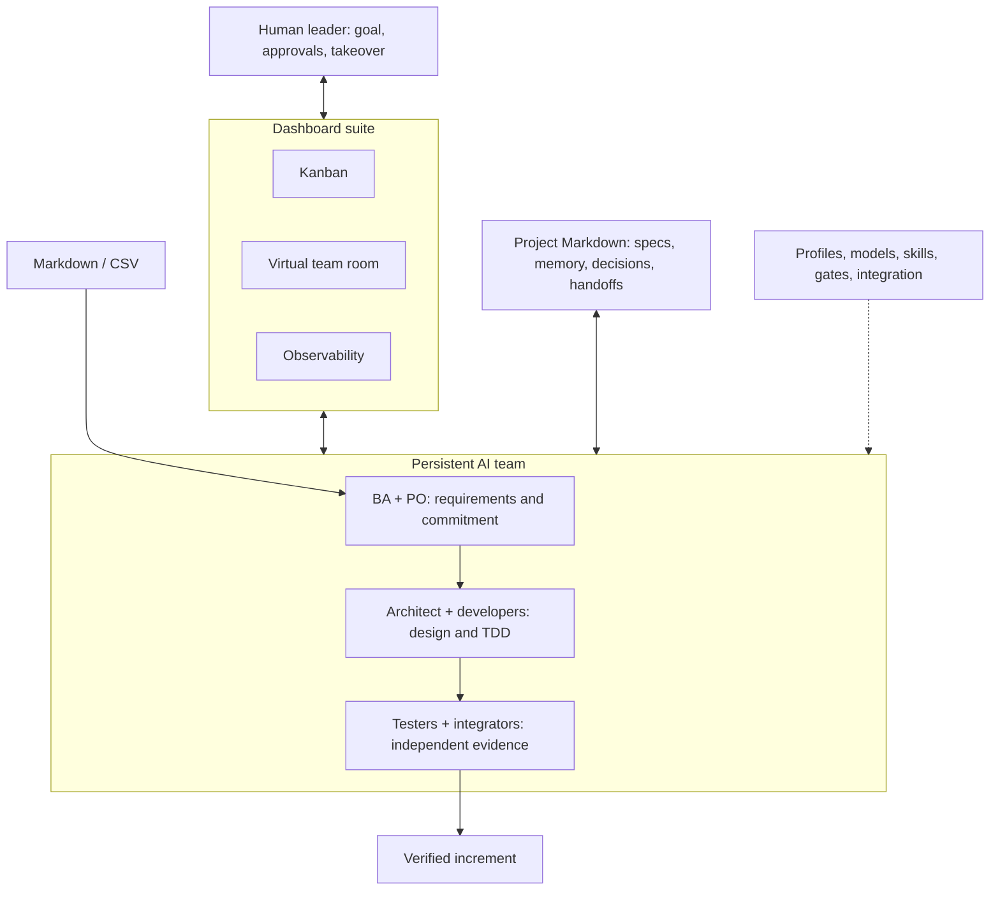

# agentcrew — Product Requirements Document

Version: 1.0 · Date: 2026-10-11 · Target: AI Team Workspace v1

Status: agreed product direction, specified but **not implemented**. This document
records the October design interview. Acceptance criteria describe the target,
not evidence that the current release meets it.

Audience: product owners, operators, designers, engineering, and acceptance testers.
Technical companion: [TRD](TRD.md). Document authority and the legacy section map:
[PRODUCT.md](../PRODUCT.md). Decision rationale: [Backlog decisions](../backlog/decisions/).

## Contents

1. [Purpose and outcomes](#1-purpose-and-outcomes)
2. [Scope and constraints](#2-scope-and-constraints)
3. [Vocabulary and users](#3-vocabulary-and-users)
4. [Experience and journeys](#4-experience-and-journeys)
5. [Setup and settings](#5-setup-and-settings)
6. [Team and role contracts](#6-team-and-role-contracts)
7. [Inputs and iteration planning](#7-inputs-and-iteration-planning)
8. [Execution and delivery](#8-execution-and-delivery)
9. [Human control and approval](#9-human-control-and-approval)
10. [Popup scope changes](#10-popup-scope-changes)
11. [Knowledge and skills](#11-knowledge-and-skills)
12. [Dashboard suite](#12-dashboard-suite)
13. [Observability and diagnostics](#13-observability-and-diagnostics)
14. [Quality and operational requirements](#14-quality-and-operational-requirements)
15. [User stories](#15-user-stories)
16. [Acceptance and traceability](#16-acceptance-and-traceability)
17. [Delivery stages and risks](#17-delivery-stages-and-risks)

## 1. Purpose and outcomes

### 1.1 Product promise

**Delegate an iteration to an AI software team. See progress and risks. Intervene
without losing context.**

agentcrew becomes a local web workspace for a persistent team of specialized
agents. The human sets the goal, approves the commitment, chooses their involvement,
and can talk to or take control of any team member. Agents plan, design, implement,
test, and integrate work through explicit, observable handoffs.

The existing installer remains useful infrastructure. The name stays **agentcrew**;
renaming is a separate future decision.

### 1.2 Problem

Running several coding CLIs leaves the operator to reconstruct who owns each task,
what each agent knows, which decisions were approved, and whether independently
completed changes work together. Chat history alone does not provide delivery
accountability. More sessions can multiply coordination and review work.

The product must connect requirements, decisions, people-facing controls, execution,
and evidence into one workflow. A busy agent or completed conversation is not proof
of a completed task or correct product.

### 1.3 Outcomes and success evidence

| Outcome | Evidence required for v1 |
|---|---|
| Complete delivery loop | One real iteration from imported requirements to reviewed, integrated, acceptance-tested code |
| Human control | Operator answers questions, takes over, directs tools, and hands back without concurrent autonomous input |
| Visible ownership | Every active assignment identifies its agent, task, stage, revision, and current blocker |
| Requirement coverage | Every committed requirement maps to tasks and an integrated acceptance result; gaps prevent successful closure |
| Durable work | Browser reconnect and supervisor restart preserve acknowledged commands, decisions, artifacts, and history |
| Explainable change | Popup work is distinguishable from baseline work; impact links to evidence |
| Provider portability | agy, Codex, and Gemini pass the documented capability contract on supported platforms |
| Owned knowledge | Tasks, specs, role definitions, memory, and handoffs remain readable without the application |

V1 does not claim a percentage productivity improvement. It establishes trustworthy
measurements for later comparison. Provider subscription access is a deployment
prerequisite, not a guarantee of unlimited capacity, fixed cost, or model availability.

## 2. Scope and constraints

### 2.1 Included

- One human operator, local browser, local supervisor, one repository per workspace.
- One active iteration per workspace; completed iterations remain inspectable.
- Configurable team with six role types, defaulting to thirteen named agents.
- Markdown/CSV intake, planning, execution, testing, review, and GitHub integration.
- Browser chat, questions, permissions, takeover, interruption, and handback.
- Kanban, minimal pixel-art team room, and observability dashboard.
- Project-owned memory and skills; configurable approvals and integration strategy.
- CLI-backed providers first: agy, Codex, Gemini. No requirement to install all three
  on every operator's machine; all three must be qualified for the product release.
- Automatic diagnostics through an assigned roster agent and its configured provider.

### 2.2 Deferred

Direct REST/API execution adapters; Claude adapter qualification; remote or shared
human workspaces; cross-repository iterations; PI events and portfolio planning;
Jira and other source connectors; learned workload estimation; production/test
environment provisioning; deployments and rollback automation; arbitrary workflow
graph editing; room customization and elaborate animation; native terminal embedding.

Future connectors must preserve local Markdown snapshots with provenance. They must
not make agents repeatedly fetch ordinary planning context from remote MCP services.

### 2.3 Boundaries

- No mandatory account or hosted service for agentcrew itself. Provider inference,
  GitHub, and CI may require network access and their own accounts.
- Backlog.md owns execution tasks. GitHub issues are optional, manually promoted
  intake; task status is not synchronized back to issues.
- GitHub PRs/checks are delivery artifacts, not a second task board.
- Local data remains readable if a dependency disappears. Dependencies and a frontend
  build are allowed; mandatory hosted infrastructure is not.
- Windows and Linux are required release platforms. macOS remains an additional
  validation target; unsupported behavior must be labeled rather than assumed.
- The default local runtime is not a security sandbox. Worktrees isolate changes.

## 3. Vocabulary and users

| Term | Definition |
|---|---|
| Operator | The one human controlling this workspace |
| Workspace | Project configuration, repository, team, and local runtime history |
| Agent identity | Persistent named team member with role, memory, and configuration |
| Role | Responsibilities, allowed inputs, outputs, skills, and review obligations |
| Assignment | One bounded piece of work for one agent; may span several sessions |
| Session / turn | Provider conversation / one submitted request and its response cycle |
| Iteration | Approved goal, time window, baseline scope, and acceptance checklist |
| Task | Backlog.md unit of execution intent, with DoD and ownership |
| Handoff | Evidence-bearing request to transfer work or obtain a review |
| Review | Recorded judgment against specific artifact and requirement revisions |
| Approval gate | Framework-enforced authorization needed before a transition |
| Takeover | Exclusive human control of an agent's working conversation |
| Popup ticket | Tracked proposed scope change after the iteration starts |
| Integrated acceptance | Verification of the combined increment against the iteration checklist |
| Autopilot | Automation within configured gates; not unrestricted authority |

The primary user wears several hats: sponsor setting goals, operator answering
agents, reviewer inspecting changes, and delivery lead investigating outcomes.
Customers supply requirements but do not need accounts or direct application access.
Agents are workers in the workflow, not additional authenticated human users.

## 4. Experience and journeys

### 4.1 First iteration

1. Open an existing Git repository and complete setup/readiness checks.
2. Import requirements; inspect the source preview and mapping before confirming.
3. State an iteration goal and deadline. BA, PO, and architect prepare linked artifacts.
4. Resolve clarification questions. Approve scope, tasks, architecture, and acceptance.
5. Start the iteration. Ready work is dispatched within concurrency limits.
6. Inspect progress, chat, answer questions, or take over an agent as needed.
7. Review and merge according to chosen strategy and gate settings.
8. Inspect integrated acceptance. Close successfully only when required evidence passes.

### 4.2 Intervention

An agent needs a decision. A persistent inbox item identifies the task, question,
evidence, and consequence of waiting. The operator may answer, inspect the transcript,
or request takeover. Takeover visibly transitions through pausing before human
control is granted. On handback, the agent receives the recorded guidance and resumes
only when the assignment is still valid.

### 4.3 Changed requirement

A revised CSV, a chat instruction, or a human edit changes approved behavior. The
system retains the old baseline, creates a popup ticket, pauses affected work, and
asks the team for impact analysis. Approval includes the revised commitment. A
rejected change remains recorded and does not alter execution scope.

### 4.4 Recovery and investigation

After a crash, the supervisor reconciles processes, files, and external operations
before one recovery attempt. Uncertainty becomes visible rather than guessed away.
The operator can later follow a failed task from source requirement to design review,
tool events, rework, CI, and final resolution.

## 5. Setup and settings

**PRD-SET-01 — Project setup.** Setup shall be resumable and idempotent. It shall
validate the repository, select the target branch and integration strategy, configure
team profiles and GitHub, and report readiness before enabling execution. Existing
tasks, memories, and hand-written rules must survive re-running setup.

**PRD-SET-02 — Profiles and providers.** Each profile shall expose name, avatar,
role, provider/model, supported reasoning options, skills, inputs, and outputs.
Role defaults may be overridden per agent. Unsupported model/options shall fail
validation visibly; no silent substitution. The UI may display provider-reported
choices or accept a validated configured identifier. It must not hardcode a promise
that a model such as Astra exists for every CLI/account.

**PRD-SET-03 — Policy settings.** Settings shall expose human gates, review-cycle
limits, memory consolidation mode, concurrency, and integration strategy. Show the
effective values after overrides and a plain-language preview of their consequences.

**PRD-SET-04 — Versioned changes.** Assignments shall retain the profile, skills,
and policy revisions with which they started. Ordinary changes apply to the next
assignment. Applying them to active work requires an explicit pause and handoff.
Changing settings alone does not dismiss pending approvals. Integration strategy
changes take effect next iteration, not halfway through existing PRs.

| Setting | Default | Allowed adjustment |
|---|---|---|
| Team | 1 BA, 1 PO, 1 architect, 4 developers, 4 testers, 2 integrators | Counts, names, avatars, role instructions |
| Active turns | 4 globally | Positive global cap and per-provider caps no higher than it |
| Assignment ownership | One active assignment per agent | Queue additional work; expand roster for parallel ownership |
| Integration | Iteration branch recommended in setup | Direct task PRs to target |
| Plan approval | Human | Mandatory before iteration execution |
| Architecture/design/test gates | Role review, human notified | Require human approval at each selected stage |
| Merge | Human | Explicit automatic merge after all required checks |
| Failed rework cycles | 2 per review stage | Escalate first rejection, or choose another positive limit |
| Long-term memory | Human reviews proposal | Automatic application with audit and archived predecessors |
| Diagnostic rule changes | Human approves | Mandatory; separate from memory consolidation |
| Recovery | One guarded attempt | Human intervention after failure/uncertainty |

For acceptance fixtures, the iteration-branch strategy is selected. The setup user
must see and confirm the actual strategy. A usable team needs coverage of every
required role; zero-count required roles prevent execution readiness.

## 6. Team and role contracts

**PRD-TEAM-01 — Persistent roster.** Identities shall survive process exit, session
compaction, provider change, and iteration closure. Removed agents are retired with
history, not erased. Retirement of an assigned agent requires reassignment/handoff.

**PRD-TEAM-02 — Structured cooperation.** Agents shall request work/review from
roster members through visible handoffs. CLI-created extra helpers are disabled.
An adapter without verified enforcement cannot qualify for supervised v1 execution.

**PRD-TEAM-03 — Roles.** The fixed v1 role stages have these contracts:

| Role | Accepts | Produces | Authority and limits |
|---|---|---|---|
| BA | Source snapshots, customer clarification, popup proposals | Requirement IDs, spec revisions, assumptions, ambiguity list | Clarifies meaning; cannot silently change approved scope |
| PO | Specs, iteration goal/deadline, architecture constraints, capacity | Tasks, DoDs, dependencies, iteration checklist, impact/replan proposal | Prioritizes ready work; operator accepts commitment changes |
| Architect | Specs, constraints, developer designs, integration questions | Architecture requirements/decisions, design review, resolution rationale | Judges architecture; cannot waive acceptance or mandatory human gates |
| Developer | Ready task, approved applicable design constraints | Detailed design, TDD evidence, code commits, handoff | Implements agreed scope; requests design approval before coding |
| Tester | Candidate commit, DoD, requirements, test instructions | Independent tests, regression/acceptance report, defects, evidence | Can reject work; does not replace developer-owned TDD |
| Integrator | Reviewed candidate, design agreement, tester evidence, CI | PR review, integration result, conflict handoff, release evidence bundle | Coordinates merges under policy; consults architect for design conflicts |

**PRD-TEAM-04 — Handoffs.** A handoff shall name sender, recipient role/agent,
task/stage, artifact revisions, completed work, unresolved questions, requested
decision, and acceptance criteria. Reference authoritative artifacts rather than
copying entire conversations. The framework validates prerequisites before routing.

Diagnostics and retrospectives are assignments to a configured roster member,
defaulting to the PO. They share normal concurrency and provider limits. No hidden
extra agent or paid API is required for supervisory reasoning.

## 7. Inputs and iteration planning

**PRD-PLAN-01 — Imports.** Accept local Markdown and UTF-8 CSV. Preserve original
bytes and a readable Markdown snapshot with source name, import time, hash, and
revision. CSV preview shall let the user map identifier, title, description, and
optional priority/acceptance fields. Missing identifiers receive stable local IDs;
ambiguous duplicate IDs and malformed records require correction before import.

**PRD-PLAN-02 — Provenance.** Derived specs shall reference source rows/sections
and revisions. Re-import shows additions, changes, and removals; identical content
does not duplicate requirements. A missing row is a proposed removal, not permission
to discard active work. Source prose is evidence, not executable agent instructions.

**PRD-PLAN-03 — Joint planning package.** Before approval, BA, PO, and architect
shall provide the goal, included/excluded requirements, assumptions, open questions,
task DoDs, dependencies, architecture constraints, integration strategy, and integrated
acceptance checklist. Unresolved blocking questions prevent readiness.

**PRD-PLAN-04 — Baseline.** Approval shall identify exact package revisions and
record approver/time. Start captures these as an immutable baseline. Detailed
developer designs follow this approval and receive architectural review per policy.
Editing a baselined artifact creates a revision and review, not an invisible rewrite.

**PRD-PLAN-05 — Deadline and closure.** At deadline, flag overdue work, stop new
dispatch, and let active turns reach a safe boundary with bounded interruption.
Ask the operator to extend, defer, or close. Closing incomplete is distinct from
successful completion. Scope removed to finish an iteration requires an approved
popup and remains visible in baseline-versus-final reporting.

Before iteration start, changing draft requirements is ordinary planning and does
not create popup work. Preparing the approved plan is distinct from starting execution.

## 8. Execution and delivery

**PRD-EXEC-01 — Task board.** Backlog.md is the authoritative task list and coarse
status. The UI shall show task stage, assignment, health, approvals, and evidence
alongside it. Dragging a card is a requested transition, not authority to skip gates.

**PRD-EXEC-02 — Dispatch.** Only tasks with satisfied dependencies, valid scope,
available role coverage, and passed gates may run. Waiting for a person, reviewer,
provider capacity, or dependency must be distinguishable. Four active CLI turns is
the default cap, not thirteen continuously running processes.

**PRD-EXEC-03 — Design and TDD.** Developers shall submit detailed designs to the
architect, then implement using failing tests followed by passing tests and recorded
validation. Repository-wide checks and meaningful manual verification may supplement
TDD; an inapplicable test requirement needs a recorded rationale/review, not fabricated
red/green evidence.

**PRD-EXEC-04 — Independent testing.** Testers verify candidate commits against
the task DoD, requirement revisions, and relevant regressions. Failure returns work
with reproducible evidence. Developer self-approval cannot satisfy independent review.

**PRD-EXEC-05 — Revision-bound review.** Integrators assess code and test evidence
against the agreed design. Reviews record the exact commit and applicable artifact
versions. New commits invalidate code/test/integration approvals for that candidate;
changed requirements/design invalidate their dependent evidence too.

**PRD-EXEC-06 — Isolation.** Each implementation task gets a branch and worktree.
Testers/integrators inspect recorded revisions without racing a developer's mutable
checkout. Integration conflicts return to explicit resolution and revalidation.

**PRD-EXEC-07 — Integration strategies.** Support both strategies below. Explain
their consequences in setup and Settings. Required CI/reviews apply under both.

| Strategy | Task PR base | Final verification | Tradeoff |
|---|---|---|---|
| Iteration branch | Iteration branch created from target | Test combined candidate; final PR to target | More merge steps; complete increment verified before target receives it |
| Direct to target | Target branch | Integrated checks after merges; final iteration checklist on resulting target | Smaller changes land sooner; target contains partial iteration work |

**PRD-EXEC-08 — GitHub and CI.** Link branches, PRs, checks, and review evidence.
Display external failure, unavailable authentication, and stale check results.
Default human merge gates apply at task and final integration stages. Autopilot
may merge only when exact-current-candidate checks and required gates pass; it must
not bypass branch protection. Agentcrew manages no deployments in v1.

**PRD-EXEC-09 — Integrated acceptance.** Before successful closure, verify the
combined result against the approved checklist and report pass/fail evidence per
requirement. A provider saying “done,” all tasks showing Done, or a green isolated
unit test suite is insufficient. Final delivery includes the code revision, source
coverage, reviews, CI/test results, popup outcomes, and remaining nonblocking issues.

## 9. Human control and approval

**PRD-CTRL-01 — Individual chat.** The operator may message any active or idle
roster member. Show queued/sent/acknowledged/failed state. Ordinary input to busy
agents waits for a safe turn boundary; no simultaneous advisory session is silently
created. Decisions affecting others become visible handoffs or change proposals.

**PRD-CTRL-02 — Takeover.** Request takeover, display pausing, then grant exclusive
human control after autonomous execution is stopped or safely reconciled. Human
messages may drive the agent's tools under the effective permission policy. The
Takeover Console offers explicit Chat and Shell modes, defaults to Chat, and allows a
`!` prefix to force one shell command. Shell execution requires human ownership.
Handback records guidance and rechecks assignment validity. If safe takeover fails,
show a blocked state; do not claim control while autonomous work continues.

Takeover is scoped to one agent. Concurrent requests for that agent conflict. Only
the acquiring tab's session token may send takeover chat, release control, or open
that agent's separate shell channel. Human chat continues in the agent's own provider
session; shell access is an explicit mode.

**PRD-CTRL-03 — Approval inbox.** Questions, permissions, reviews, merges, popup
decisions, recovery uncertainty, and diagnostic proposals persist until resolved or
explicitly superseded. Show requested action, evidence/revision, blocking effect,
age, and decision history. Browser closure never implies consent.

**PRD-CTRL-04 — Involvement presets.** Provide Guided, Automatic, and Full autopilot
presets plus per-gate overrides. Automatic is the default: plan approval, role reviews,
human merges, human memory consolidation, and exception escalation. Guided enables
all optional human stage gates and first-disagreement escalation. Full autopilot
enables automatic merges/memory application and bounded internal rework. The human
still approves initial commitment, popup/recommitment, and diagnostic rule changes.

**PRD-CTRL-05 — Disagreements.** Count failed rework cycles separately for each
task and review stage. Default: after two unsuccessful resubmissions, block and
escalate with both positions, referenced requirements, revision history, and evidence.
A first-disagreement setting escalates on initial rejection. Track counts even when
the configured threshold is larger; a new session does not reset them.

**PRD-CTRL-06 — Stop and recovery.** Operator may pause the iteration, stop a task,
or interrupt an agent. Keep resumable work and evidence. Unexpected failure gets one
guarded recovery attempt on the same provider, subject to reconciliation. Unknown
merge/tool effects, lost authentication, or failed recovery require intervention.

## 10. Popup scope changes

**PRD-CHANGE-01 — Creation.** After start, any proposed change to approved scope,
requirements, DoD, or acceptance creates a Backlog popup ticket. Link the source
revision/chat/event and affected tasks. Fixing code that fails an unchanged DoD is
ordinary rework, not automatically a scope change.

**PRD-CHANGE-02 — Impact analysis.** The PO coordinates BA, architect, developer,
tester, and integrator input as applicable. Report affected requirements/artifacts,
completed/in-progress work, reusable portions, discarded portions and why, additional
tasks/testing, risks, and forecast delivery effect. Show uncertain ranges and their
basis rather than presenting guesses as measured effort.

**PRD-CHANGE-03 — Approval.** One persistent approval view presents the impact
report and revised commitment: add, replace, defer, extend, or reject. The operator
approves even in autopilot. Pause affected assignments safely while unaffected work
continues. Withdrawn/rejected proposals remain visible with rationale.

**PRD-CHANGE-04 — Execution and reporting.** Approved popup tickets link to new or
revised implementation tasks; the popup itself is not a substitute for all execution
work. Preserve before/after scope and estimate versions. Report actual execution,
waiting, rework/discarded effort, and observed schedule changes separately from the
forecast. Overlapping change impacts must not be counted twice as elapsed delay.

Example: a request adds CSV export after login is implemented. Popup P1 identifies
the new requirement, reusable authorization work, added developer/tester tasks,
estimated extra effort, and the task proposed for deferral. Approval changes the
commitment but leaves the original iteration baseline intact for reporting.

## 11. Knowledge and skills

**PRD-KNOW-01 — Owned artifacts.** Store roles, configuration, source snapshots,
specs, plans, handoffs, review summaries, skills, and per-agent memory as readable
project Markdown. Keep full transcripts, frequent events, and large runtime payloads
outside Git. Provide links between summaries and local runtime evidence.

**PRD-KNOW-02 — Memory lifecycle.** Each agent has short-term notes, long-term
memory, and linked archives. Append short-term notes during/after work. Consolidation
creates a reviewable proposal; default requires approval, while explicitly configured
autopilot may apply it with the prior version archived. Project decisions and other
agents' memories are references, not silently rewritten copies.

**PRD-KNOW-03 — Context and portability.** New sessions load the role/skill revision,
applicable project rules, long-term memory, recent notes, current assignment, and
handoff. Provider switching preserves these artifacts, not a guarantee of identical
native conversation history. Resume the original conversation only when supported.

**PRD-KNOW-04 — Skills.** Keep reviewed skill content in the project, with provenance,
version, and license metadata. Assign by role or agent. Reuse handoff, TDD, and review
patterns where appropriate; skills guide judgment while the framework enforces gates.
Skill installation/update is an explicit setup/settings action, not agent improvisation.

## 12. Dashboard suite

**PRD-UI-01 — Navigation.** Separate full-screen Planning/artifacts, Kanban, Team
Room, Observability, Sessions/history, and Settings views. Preserve project/iteration
context and deep-linkable selections across views. A global attention count opens
the same persistent inbox from any dashboard.

**PRD-UI-02 — Kanban.** Show coarse status, workflow stage, owner, task health,
dependencies, reviews, last activity, and popup badge. Filter by role/agent, stage,
blocked reason, baseline/popup, and requirement. Opening a card reveals DoD, sources,
handoffs, candidate revision, and actions allowed in the current state.

**PRD-UI-03 — Team room.** Present a status-grouped agent roster with search and
filters beside a focused workspace for the selected agent, including its shared
conversation/session controls. Provide the minimal isometric pixel-art office as a
secondary map view. Show named identities, role, provider/model, and real activity
badges. Simple animation reflects real state; never invent meetings or work. Offer
equivalent keyboard/list navigation, reduced motion, and text labels for state.

**PRD-UI-04 — Sessions and artifacts.** Display user/agent messages, tools, outcomes,
questions, permissions, interruptions, and handoffs in order. Show provider/model,
configuration revision, ownership, and transcript completeness. Artifact views show
revision diffs and source links. Large logs open separately instead of flooding chat.
Chat replies identify the provider that actually answered, including after failover.
Provider health distinguishes available, unavailable, and quota-limited runners and
shows a known quota reset time.

**PRD-UI-05 — Empty and failure states.** A new project directs the operator to
setup/import. Unconfigured providers show requirements, not fake availability.
Disconnected views show their last update and block unsafe commands until reconnected.
Missing artifacts, archived transcripts, invalid imports, and failed operations have
specific recovery actions. Mobile layout and detailed room decoration are deferred.

## 13. Observability and diagnostics

**PRD-OBS-01 — Live state.** Show executing, ready/queued, awaiting human, blocked,
idle, provider-limited, and failed work. Counts and timelines use the same event data
as task/session detail; disagreeing projections show a reconciliation warning.

**PRD-OBS-02 — Delivery and quality.** Expose cycle time, blocked time, human wait,
review/rework cycles, independent and integrated acceptance pass rates, session
failures/recoveries, and popup impact. Filter by iteration, agent, role, provider,
stage, and task. Drill down from every metric to its evidence and definition.

**PRD-OBS-03 — Utilization.** For each agent, show a stacked activity timeline and
execution percentage over the active iteration wall-clock window, excluding explicit
iteration pauses. Distinguish executing, queued, awaiting human, blocked, idle, and
unknown observation periods. Label this **session activity**, not CPU/model utilization.
Show newly added/retired agents' eligible windows and data coverage.

**PRD-OBS-04 — Diagnostics.** Run on demand, after a review-loop escalation or failed
guarded recovery, and at iteration close. Analyze recorded evidence using the assigned
roster agent. Provide findings, evidence links, uncertainty, and proposed role/skill/
gate changes. Repeated symptoms are not proof of root cause. Human approval is required
before applying changes to governing instructions, including in full autopilot.

**PRD-OBS-05 — Usage and history.** Show tokens/cost only when reported with known
units and coverage. Missing cost is unknown, not zero. Preserve iteration summaries
and event archives for future efficiency/estimation features. V1 impact estimates
are reasoned forecasts, not a learned historical estimation engine.

## 14. Quality and operational requirements

| ID | Requirement | Acceptance expectation |
|---|---|---|
| PRD-NFR-01 | Persistence | Acknowledged input/approval survives restart; uncertain external effects require reconciliation |
| PRD-NFR-02 | Local independence | Local planning/history remain usable during network loss; remote-dependent actions visibly wait |
| PRD-NFR-03 | Responsiveness | Control acknowledgement and live projections meet TRD targets under the documented fixture workload |
| PRD-NFR-04 | Access and secrets | Local-only access, explicit authorization, no provider credential extraction, no secrets in committed evidence |
| PRD-NFR-05 | Accessibility | Keyboard access to essential controls, text state labels, readable desktop layout, reduced motion |
| PRD-NFR-06 | Compatibility | Windows/Linux verification; existing project knowledge and installer workflows preserved during migration |
| PRD-NFR-07 | Explainability | State changes expose actor, reason, revision, and causal evidence |
| PRD-NFR-08 | Honest support | Required provider capability failures block qualification; mocks alone never establish real support |

Numerical engineering targets in the TRD are proposed acceptance budgets, not measured
current performance. Benchmark results must state hardware, versions, and data volume.

## 15. User stories

Each story inherits the numbered requirements in the referenced area; acceptance
scenarios in §16 exercise the journeys across roles.

| ID | Story | Requirement area |
|---|---|---|
| US-01 | As an operator, I want resumable setup so existing project knowledge stays safe. | SET |
| US-02 | As an operator, I want named profiles and avatars so I recognize each team member. | SET, TEAM |
| US-03 | As an operator, I want role/model overrides so quality reviews can use suitable models. | SET |
| US-04 | As an operator, I want readiness checks so missing authentication/capabilities are known before work starts. | SET, NFR |
| US-05 | As a sponsor, I want Markdown/CSV intake so existing requirements become usable context. | PLAN |
| US-06 | As a reviewer, I want source revisions so I can distinguish customer input from agent interpretation. | PLAN |
| US-07 | As a sponsor, I want a joint planning package so I approve a coherent commitment. | PLAN |
| US-08 | As an operator, I want dependency-aware dispatch so blocked tasks do not waste active slots. | EXEC |
| US-09 | As an operator, I want concurrency limits so team size does not dictate simultaneous provider usage. | SET, EXEC |
| US-10 | As an architect reviewer, I want detailed designs before implementation so architectural disagreements surface early. | EXEC |
| US-11 | As a delivery lead, I want developer TDD evidence so implementation is validated during construction. | EXEC |
| US-12 | As a delivery lead, I want independent testing so the developer's interpretation is challenged. | EXEC |
| US-13 | As an integrator, I want exact-revision evidence so I know what was approved. | EXEC |
| US-14 | As an operator, I want isolated task branches so parallel developers do not overwrite each other. | EXEC |
| US-15 | As an operator, I want integration choices so delivery matches the repository's practices. | EXEC, SET |
| US-16 | As a reviewer, I want human merge by default so delivery remains under my control. | EXEC, CTRL |
| US-17 | As an operator, I want configurable autopilot so routine handoffs can proceed without repeated approval. | CTRL |
| US-18 | As an operator, I want to chat with any agent so I can clarify work directly. | CTRL |
| US-19 | As an operator, I want explicit takeover so urgent guidance stops autonomous dispatch first. | CTRL |
| US-20 | As an operator, I want a durable inbox so closing the browser loses no questions. | CTRL |
| US-21 | As an operator, I want bounded disagreement loops so agents cannot rework forever. | CTRL |
| US-22 | As a sponsor, I want popup impact analysis so changed requirements have visible consequences. | CHANGE |
| US-23 | As a sponsor, I want to approve replacement/deferred work so the team cannot silently redefine success. | CHANGE |
| US-24 | As a delivery lead, I want baseline-versus-final reporting so scope-driven effort is distinguishable. | CHANGE, OBS |
| US-25 | As an operator, I want readable agent memories so I can correct repeated misunderstandings. | KNOW |
| US-26 | As an operator, I want archived memory versions so automatic consolidation is reversible. | KNOW |
| US-27 | As an operator, I want project-owned skills so team behavior is reviewable and reproducible. | KNOW |
| US-28 | As an operator, I want provider changes with handoffs so agent identity outlives one CLI conversation. | KNOW, CTRL |
| US-29 | As an operator, I want an actionable Kanban so progress and blockers are visible together. | UI |
| US-30 | As an operator, I want a team room so direct conversations feel like working with colleagues. | UI |
| US-31 | As a delivery lead, I want evidence-linked KPIs so I can investigate delays and quality problems. | OBS |
| US-32 | As a delivery lead, I want utilization categories so waiting is not mistaken for productive execution. | OBS |
| US-33 | As an operator, I want proposed diagnostics so recurring problems can improve future team behavior. | OBS |
| US-34 | As an operator, I want guarded recovery so a crash does not duplicate uncertain actions. | CTRL, NFR |
| US-35 | As a sponsor, I want integrated acceptance so task completion means a working increment. | EXEC |
| US-36 | As a sponsor, I want an explicit deadline decision so missed commitments are never hidden. | PLAN |

## 16. Acceptance and traceability

### 16.1 End-to-end acceptance scenarios

| Scenario | Setup/action | Required result |
|---|---|---|
| AT-01 Setup | Re-run setup on an existing fixture repo; change team counts/models | No lost files or duplicate tasks; invalid coverage/provider blocks readiness |
| AT-02 Intake | Import Markdown and mapped CSV twice; change one row | Stable source IDs, no identical duplicates, reviewable revision diff |
| AT-03 Planning | Prepare package with a missing acceptance link, then correct it | Approval blocked until complete; approved revision becomes baseline |
| AT-04 Team delivery | Run thirteen identities with cap four through the whole workflow | No cap breach, roster-only delegation, attributable handoffs and artifacts |
| AT-05 Takeover | Queue chat during work, request takeover, issue a tool-driving instruction, release | Ordered messages, exclusive control, usable human-directed tools, valid resumption |
| AT-06 Gates | Exercise Guided, Automatic, Full autopilot and overrides | Effective policy visible; mandatory approvals persist in all modes |
| AT-07 Review | Reject, resubmit, reject twice; later change approved code | Escalation at configured threshold; changed candidate loses stale approvals |
| AT-08 Popup | Change DoD during work; reject once, approve revised commitment later | Affected work held; baseline preserved; linked tasks and forecast/actual impact |
| AT-09 Integration | Deliver dependent tasks under each strategy; introduce conflict/failed CI | No unsafe merge; combined acceptance runs on the resulting revision |
| AT-10 Recovery | Close browser; restart supervisor around an uncertain external operation | Durable inbox/history; reconcile before one guarded attempt; no blind replay |
| AT-11 Knowledge | Consolidate in human/automatic modes; switch provider | Correct gate; archived predecessor; fresh context handoff or verified native resume |
| AT-12 Dashboards | Inspect identical work in all views, including reduced-motion/list mode | Consistent states, functional keyboard controls, usable empty/error states |
| AT-13 Metrics | Replay known timings, overlapping popup impacts, and an observation gap | Reproducible totals, no double-counted elapsed delay, explicit unknown time |
| AT-14 Diagnostics | Trigger repeated failure and iteration closure | Evidence-backed proposals; no automatic governing-rule change |
| AT-15 Deadline | Reach deadline with active and queued work | Safe boundary, held new work, explicit extend/defer/close decision |
| AT-16 Release | Run provider/platform contract suite and complete integrated acceptance | Three qualified providers; Windows/Linux results; no credentials in CI |

### 16.2 Requirements-to-design matrix

Every numbered requirement belongs to one row below. Each maps to a TRD section
and at least one acceptance scenario; the TRD expands the verification mechanisms.

| Requirements | TRD sections | Acceptance |
|---|---|---|
| PRD-SET-01–04 | 2, 3, 5, 12, 15 | AT-01, AT-06 |
| PRD-TEAM-01–04 | 4, 6, 7, 10 | AT-04, AT-07 |
| PRD-PLAN-01–05 | 4, 6, 10, 11 | AT-02, AT-03, AT-15 |
| PRD-EXEC-01–09 | 6, 7, 9, 10 | AT-04, AT-07, AT-09, AT-16 |
| PRD-CTRL-01–06 | 5, 7, 8, 12, 13 | AT-05, AT-06, AT-07, AT-10 |
| PRD-CHANGE-01–04 | 6, 10, 11, 14 | AT-08, AT-13 |
| PRD-KNOW-01–04 | 4, 5, 10, 11 | AT-11 |
| PRD-UI-01–05 | 3, 12, 13 | AT-12 |
| PRD-OBS-01–05 | 7, 11, 14 | AT-13, AT-14 |
| PRD-NFR-01–08 | 8, 11, 13, 15, 16 | AT-10, AT-12, AT-16 |

## 17. Delivery stages and risks

| Stage | Exit evidence |
|---|---|
| 0 — Specifications | PRD/TRD and superseding decisions consistent; provider assumptions labeled |
| 1 — Provider feasibility | Real protocol fixtures for all required controls; blocker report for failures |
| 2 — Durable execution | Identities, storage, scheduler, takeover, recovery, worktree isolation pass contracts |
| 3 — Complete workflow | Imported requirement reaches integrated acceptance with roles and gates |
| 4 — Dashboard suite | Setup, Kanban, team room, observability, and diagnostics use the same durable state |
| 5 — Qualification | Both integration strategies, Windows/Linux matrix, real-provider evidence, documentation |

| Risk | Mitigation / release consequence |
|---|---|
| CLI lacks interruption, approval, or helper controls | Spike before dependent implementation; required contract failure blocks qualification |
| Thirteen identities overrun provider capacity | Cap active turns; surface rate limits; keep roster independent of runtime count |
| Agents reinterpret scope | Baseline revisions, source links, mandatory popup approval |
| Attractive room hides operational truth | Every avatar state derives from the same event projections as Kanban |
| Automatic merge accepts stale evidence | Revision-bound gates and serialized integration |
| Diagnostics invent causes | Evidence links, uncertainty, human approval of changes |
| Long-term memory drifts | Proposals, policy-controlled application, archived predecessors |
| Historical data looks more precise than it is | Coverage and unknown intervals; separate forecasts from observations |

The release is complete only when the integrated journey and the required provider
contracts pass. A simulated dashboard or a single working CLI is an intermediate
milestone, not the v1 product promised here.
