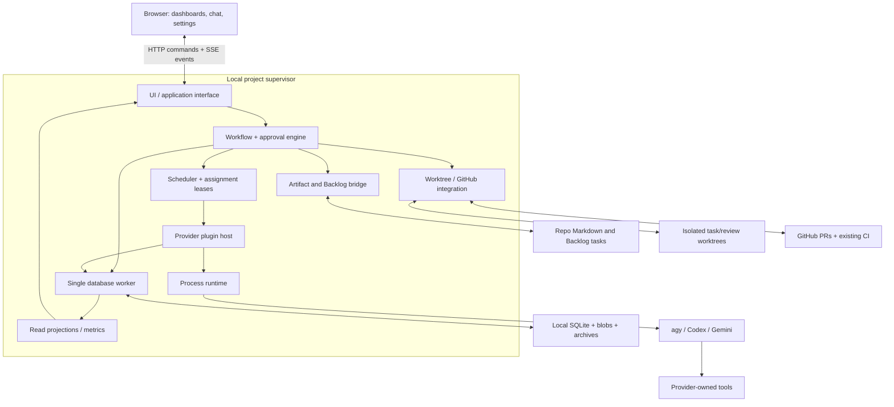
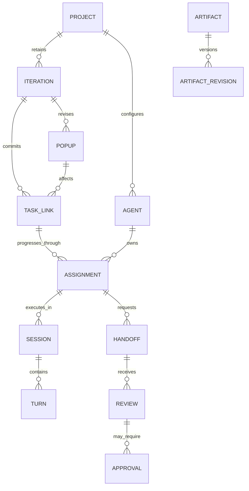
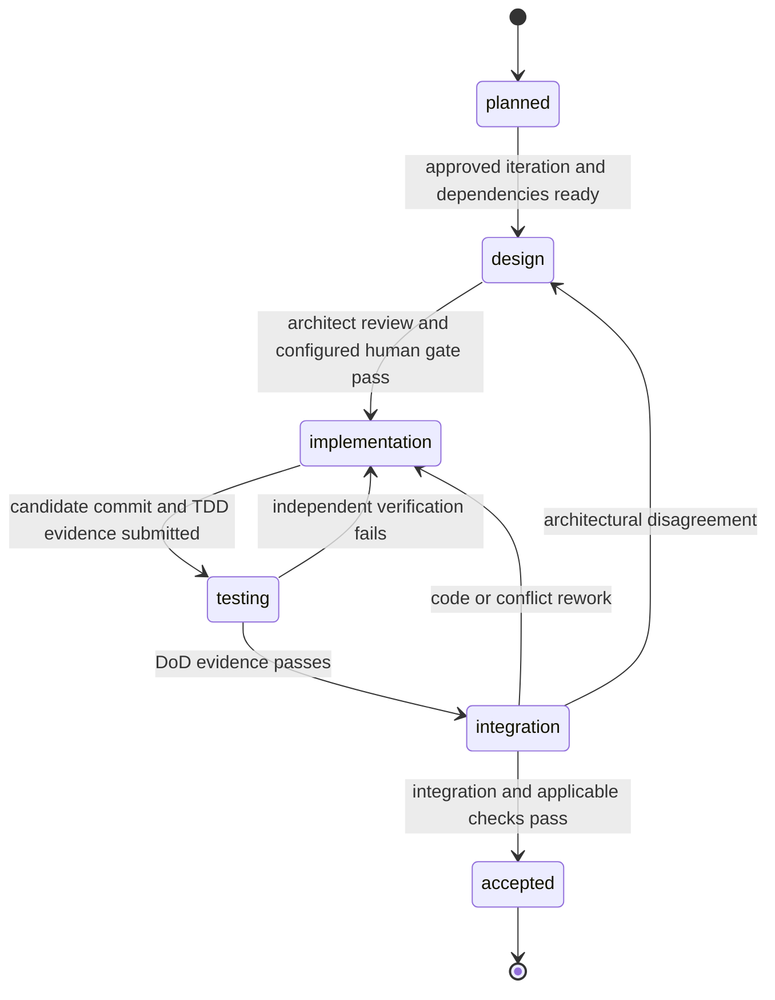

# agentcrew — Technical Requirements Document

Version: 1.0 · Date: 2026-10-11 · Target: AI Team Workspace v1

Status: **proposed implementation design** for the agreed [PRD](PRD.md).
No supervisor, provider adapter, dashboard, or schema below is implemented by this
documentation change. Public interfaces in this document are target contracts.
Provider details remain subject to the explicit qualification gates in §5 and §16.

Audience: engineers, implementation agents, security reviewers, and test engineers.
Authority and legacy references: [PRODUCT.md](../PRODUCT.md). Product behavior is
defined by PRD requirements; this document supplies mechanisms and technical defaults.
Accepted ADRs take precedence, with
[decision-7](../backlog/decisions/decision-7%20-%20AI-Team-Workspace-v1-product-scope-and-supersession-of-supervisor-assumptions.md)
qualifying older decisions. The engineering baseline is recorded separately in
[proposed decision-8](../backlog/decisions/decision-8%20-%20Proposed-technical-baseline-for-the-AI-Team-Workspace.md).
Proposed technical choices are not retroactively described as user decisions.

## Contents

1. [Design status and invariants](#1-design-status-and-invariants)
2. [Current implementation and compatibility](#2-current-implementation-and-compatibility)
3. [Architecture and technical baseline](#3-architecture-and-technical-baseline)
4. [Domain model and identity](#4-domain-model-and-identity)
5. [Provider plugins and qualification](#5-provider-plugins-and-qualification)
6. [Workflow and review contracts](#6-workflow-and-review-contracts)
7. [Scheduler and activity state](#7-scheduler-and-activity-state)
8. [Session control and recovery](#8-session-control-and-recovery)
9. [Worktrees and GitHub integration](#9-worktrees-and-github-integration)
10. [Imports, artifacts, memory, and skills](#10-imports-artifacts-memory-and-skills)
11. [Storage, events, and consistency](#11-storage-events-and-consistency)
12. [Application interfaces and UI](#12-application-interfaces-and-ui)
13. [Security and access](#13-security-and-access)
14. [Observability and diagnostics](#14-observability-and-diagnostics)
15. [Operations and performance](#15-operations-and-performance)
16. [Verification and delivery](#16-verification-and-delivery)
17. [Sources and verification register](#17-sources-and-verification-register)

## 1. Design status and invariants

The PRD records agreed product scope. This TRD fixes a coherent baseline for review
and implementation rather than offering competing architectures. Library versions,
provider wire formats, and capability evidence must be pinned during the relevant
implementation stage. A failed feasibility gate requires a recorded design revision;
it does not authorize quietly weakening the PRD.

| ID | Invariant |
|---|---|
| INV-01 | Exactly one supervisor is the runtime writer and dispatcher for a project. |
| INV-02 | Agent identity, assignment, conversation, turn, task, and OS process are separate entities. |
| INV-03 | Backlog.md is task intent; execution projections do not become a second editable task board. |
| INV-04 | No workflow transition relies solely on an agent's claim that it is done. |
| INV-05 | Approvals bind to revisions and policy; changing a candidate invalidates dependent approvals. |
| INV-06 | Human-owned sessions receive no autonomous messages; human-directed tools remain policy-controlled. |
| INV-07 | Durable acknowledgement follows persistence; uncertain external effects are reconciled, never blindly replayed. |
| INV-08 | Required provider capabilities are demonstrated, not inferred from similar flags or prose instructions. |
| INV-09 | Roster-only delegation and concurrency apply to all work, including diagnostics. |
| INV-10 | Iteration baseline and event history are immutable; corrections create new revisions/events. |
| INV-11 | Secrets stay out of committed artifacts and CI; official CLIs own inference authentication. |
| INV-12 | Missing observations, costs, and capabilities are unknown, not zero or success. |

Normative product mappings use PRD IDs; technical field names and budgets below are
implementation defaults. Changes to them need an updated TRD and, for durable
architectural changes, a Backlog decision.

## 2. Current implementation and compatibility

### 2.1 Verified repository baseline

| Area | Existing behavior | Required evolution |
|---|---|---|
| CLI | CommonJS setup/update/daemon/consolidate; package engine Node >=18 | Preserve commands; add workspace supervision/readiness commands |
| Setup | Backlog install, memory scaffold, agent-rule merge, skill install, registry | Add explicit project/team/provider/policy setup and migration preview |
| Watcher | Debounced file watch plus 30-second sweep; startup baseline in memory | Retain discovery; add durable assignment and revision reconciliation |
| Consolidation | Writes MEMORY.proposed.md; no automatic application | Keep default; add policy-controlled versioned application in new supervisor |
| Agent invocation | One-shot headless command selection; only Claude -p marked verified | Replace supervised path with provider plugins; retain legacy compatibility |
| State | Installer registry and Markdown | Add per-project event store, artifacts, commands, sessions, and projections |
| Validation | Node test suite; pull-request CI runs `npm test` on Linux | Expand fixture/contract/workflow/browser/platform suites |
| UI | None for the supervisor | Ship compiled dashboard assets with supervisor |

The old task-1 through task-10 backlog is historical planning input. Do not implement
its Claude-first, local-only, or three-screen assumptions without the compatibility
map in PRODUCT.md. Do not mark those tasks completed because documents were written.

### 2.2 Migration contract

- Existing setup/update remain idempotent and preserve custom rules, memory, and tasks.
- Detect legacy projects by absence of workspace schema metadata; offer explicit
  initialization, not silent dispatch of pre-existing In Progress tasks.
- New supervisor and old watcher must not run as independent writers on the same
  project. The new daemon incorporates the watcher/journal behavior and project lock.
- Runtime history stays outside the repository. Worktree discovery resolves the
  common Git directory so linked worktrees share the parent project identity.
- Old snapshots, source files, and memory archives remain readable after upgrades.
- The proposed application runtime floor is Node 24; existing 0.5.0 remains Node >=18
  until the implementation release changes packaging. Upgrading validates prerequisites
  and exits without partial migration when the runtime is insufficient.
- Database migrations use a schema version and backup. An older binary refuses a newer
  schema rather than attempting an implicit downgrade. Rollback restores a backup;
  post-backup events must be exported/preserved before replacement.

## 3. Architecture and technical baseline

### 3.1 Deployment

One supervisor process per project serves the browser application and owns the local
HTTP command/query interface. The browser never reads SQLite directly. SQLite access
is serialized through one database worker within that supervisor. Provider processes
and their tool processes are children managed through the runtime module.



No cloud agentcrew control plane is required. A browser disconnect affects display,
not execution. Separate projects retain separate processes, ports, locks, and stores;
cross-project aggregation is outside v1.

### 3.2 Proposed technology choices

| Area | Baseline and reason |
|---|---|
| Server/runtime | Node 24; keep existing CommonJS modules; new server contracts use JSDoc plus runtime validation |
| UI | React + TypeScript, built with Vite; static bundle served by supervisor; no development server needed for installed use |
| Team room | CSS/HTML status-grouped roster and selected-agent workspace by default; accessible isometric map as a secondary view; no game engine needed for v1 |
| UI transport | Same-origin HTTP JSON commands/queries and one replayable Server-Sent Events stream per workspace tab |
| Storage | node:sqlite, WAL, foreign keys, one worker/writer; content-addressed local blobs |
| Parsing | Maintained YAML/frontmatter, CSV, and sanitized Markdown libraries; pin versions and licenses during implementation |
| Runtime contracts | JSON Schema for command/event/plugin payloads, validated on both ingress and plugin boundaries |
| Git | git subprocess argument arrays; no shell-interpolated commands |
| GitHub | gh CLI using its existing login; normalized module interface, no copied GitHub token |
| Testing | node:test for server contracts/workflows; browser automation for UI; fake provider executables |
| Dependency policy | Lockfile-pinned, auditable, local-installable dependencies; no mandatory SaaS component |

These are proposed implementation selections, not a claim that the interview chose
React, Vite, or a Node minor. Node's SQLite interface and Vite's runtime requirements
are documented by their maintainers; exact release combinations must pass packaging
tests. See [Node SQLite](https://nodejs.org/download/release/latest-jod/docs/api/sqlite.html)
and [Vite setup](https://vite.dev/guide/).

### 3.3 Module responsibilities and test seams

| Module | Interface responsibility | Must not own |
|---|---|---|
| Workflow | Validate commands; advance tasks; request approvals/handoffs; determine readiness | Provider wire formats |
| Scheduler | Claim eligible work; capacity; leases; fair dispatch | Requirement interpretation |
| Provider host | Load approved adapters; enforce contract; normalize capabilities/events | Backlog writes or merge decisions |
| Runtime | Spawn, identify, stop, and reap owned process trees per OS | Provider-specific prompts/models |
| Artifact bridge | Validate revisions; serialize managed Markdown and Backlog mutations | Autonomous scope approval |
| Repository integration | Worktrees, candidate revisions, PR/check/merge operations | Agent role judgment |
| Store | Transactions, event append, outbox, projections, archives | Product gate decisions |
| Diagnostics | Produce evidence-backed proposals through roster assignment | Apply governing changes autonomously |
| Browser | Render state, collect commands, reconnect/replay | Infer authorization from hidden UI controls |

Test through these interfaces. Inject clock, IDs, filesystem roots, providers,
repository integration, and notifications. The highest-value workflow tests submit
the same commands as the browser and inspect durable public results.

## 4. Domain model and identity

### 4.1 Relationships



An agent has at most one active assignment; an assignment has at most one executing
turn and one current working session. Ended sessions remain linked. A task can have
sequential assignments to different roles and multiple review rounds. A paused
assignment may wait for a review assignment on another roster member.

### 4.2 Identity and revisions

- Mint internal UUIDs for project, agent, assignment, session, turn, command, review,
  approval, and event. Backlog IDs remain opaque strings owned by Backlog.md.
- Keep `provider_session_id` and `provider_turn_id` separately; never require a CLI
  to accept an agentcrew UUID. Native IDs are scoped by provider and local installation.
- Source IDs and artifact IDs remain stable across revisions. Revision IDs reference
  content hashes plus metadata; Git commit IDs identify code candidates.
- Every assignment captures `profile_revision`, `policy_revision`, `skill_revisions`,
  `requirement_revisions`, and `input_manifest_hash`.
- Every command records actor, idempotency key, requested action, expected entity
  version, and outcome. Time alone is not an idempotency key.
- Project ID is stored in the resolved common Git directory. Moved repos keep history;
  separate clones get separate identities. v1 execution requires Git.

### 4.3 Distinct states

| Entity | States / dimensions |
|---|---|
| Iteration | draft, planning, awaiting_approval, ready, running, paused, deadline_hold, accepting, completed, closed_incomplete |
| Assignment | ready, queued, running, waiting_review, waiting_human, blocked, completed, cancelled |
| Task stage | planned, design, implementation, testing, integration, accepted; rework returns to named earlier stage |
| Session health | starting, working, waiting_for_input, rate_limited, stuck, crashed, done, interrupted |
| Control ownership | auto, pausing, human_owned, releasing, blocked |
| Command | accepted, running, awaiting_reconciliation, succeeded, failed, cancelled |
| Approval | pending, approved, rejected, superseded, invalidated |
| Popup | proposed, analyzing, awaiting_approval, approved, rejected, withdrawn, executing, verified |

Backlog's coarse statuses are mapped in setup; v1 requires equivalents for To Do,
In Progress, Needs Attention, and Done. Stage/health are projections with explicit
meaning and never silently replace user-configured status names. A stopped session
does not itself move its task to Done.

## 5. Provider plugins and qualification

### 5.1 Interface

Provider selection varies behind one module interface. The runtime placement is a
separate interface; a worktree is the assignment's working directory, not a provider.
Only explicitly configured local plugins load. Plugin code is trusted local code;
the interface is not a sandbox or a plugin marketplace.

```typescript
type Capability =
  | 'stream_messages' | 'send_followup' | 'native_resume'
  | 'interrupt_turn' | 'abort_and_resume' | 'tool_events'
  | 'permission_decisions' | 'disable_native_delegation'
  | 'usage_reporting' | 'model_listing';

interface ProviderPlugin {
  manifest: { id: string; contract_version: 1; implementation_version: string };
  probe(context: ProbeContext): Promise<ProviderReport>;
  open(request: OpenSession): Promise<SessionHandle>;
}

interface SessionHandle {
  identity: { internal_session_id: string; provider_session_id: string | null };
  send(request: TurnInput): Promise<SubmissionReceipt>;
  decidePermission(request: PermissionDecision): Promise<DecisionReceipt>;
  interrupt(request: InterruptRequest): Promise<InterruptReceipt>;
  close(request: CloseRequest): Promise<CloseReceipt>;
  events: AsyncIterable<ProviderEvent>;
}
```

The types are agentcrew contracts, not vendor signatures. `OpenSession` includes
provider/model options, assignment manifest, runtime reference, cwd, and optional
native resume reference. `TurnInput` includes command/turn IDs, text/artifact refs,
and source (`human`, `workflow`, `recovery`, `diagnostic`). `send` acknowledges
submission only; the event stream reports actual turn start/completion. If receipt
is uncertain, return a typed uncertainty result rather than allowing automatic replay.

`probe` is non-billable detection/config validation where possible. Authentication
and behavioral qualification are separate checks. A version/help result does not
establish that permissions, recovery, or a particular model actually work.

### 5.2 Required and optional capability behavior

| Capability | v1 handling |
|---|---|
| Messages, tool activity, follow-up input | Required; partial text streams may be aggregated but order and completion must be preserved |
| Tool permissions | Required to honor configured human tool decisions; requests remain pending until resolved |
| Interruption | Required via verified turn interrupt or verified abort-and-resume path; show actual mechanism |
| Native resume | Optional alone; recovery must support either verified native resume or explicit fresh-session handoff |
| Roster-only delegation | Required and enforced by provider/runtime configuration, not only role prose |
| Cost/token reporting | Optional; unknown values remain null with coverage |
| Model listing | Optional; configured model must still be validated; never guess a fallback model |

An adapter that cannot enforce roster-only delegation or the human-control contract
is unavailable for v1 supervised work. Quoting instructions asking the model not to
spawn helpers is not proof of enforcement. Capabilities carry evidence references,
tested binary version, platform, and test date.

### 5.3 Initial provider evidence

| Provider | Evidence available during design | Qualification still required |
|---|---|---|
| agy | Earlier local help inspection advertised NDJSON input/output and conversation/continue options | Record exact installed version/protocol; follow-ups, approvals, interruption, native ID mapping, disabled helper behavior, recovery |
| Codex | Official app-server documentation describes bidirectional JSON-RPC-style communication over stdio | Pin binary/schema; exercise thread/turn mapping, tool approvals, interruption, restrictions, and recovery on both platforms |
| Gemini | Official headless reference describes JSONL output and tool/result events | Determine supported interactive transport; output streaming alone does not prove streaming input, takeover, or approvals |

For Codex, use the official local app-server protocol as the candidate transport,
not an assumed Claude-compatible stream. The fetched documentation describes the
app-server command as experimental, so version pinning and a maintained qualification
matrix are release risks. [Official Codex app-server documentation](https://learn.chatgpt.com/docs/app-server).

For Gemini, the headless documentation establishes structured output, not the entire
agentcrew session-control contract. The spike may need another official CLI transport;
do not replace it with direct API billing without a scope decision.
[Official Gemini headless reference](https://github.com/google-gemini/gemini-cli/blob/main/docs/cli/headless.md).

No authenticated protocol exchange was performed while writing these documents.
Historical statements in older ADRs about provider retirement, subscription terms,
identical flags, or universal session capabilities are not current evidence.

### 5.4 Protocol handling and future API adapters

Parse bounded records incrementally; stderr is diagnostic, never protocol input.
Validate vendor output inside the adapter, then validate normalized events at the
host interface. Unknown vendor messages become a sanitized diagnostic record; unknown
normalized event types are rejected and make the session's evidence incomplete.
Never silently discard a result needed for authorization or completion.

A future REST adapter must own its conversation state, tool execution, approvals,
streaming, cancellation, retries, and credentials behind the same interface. A raw
completion endpoint does not satisfy the contract. v1 does not introduce API-key
configuration merely to reserve that seam.

## 6. Workflow and review contracts

### 6.1 Fixed flow



Workflow stages are fixed in v1. Editable role/skill content cannot remove enforced
stages. Rework retains previous review records; it does not erase history.
Architecture-wide planning approval and task-level detailed-design review are distinct.

### 6.2 Ready and complete predicates

`ready(assignment)` requires an approved active scope revision, fulfilled dependencies,
available qualified role/provider, valid input manifests, satisfied gates, and no
pause/uncertainty holds. Dependency cycles block plan approval and identify the cycle.

`complete(stage)` requires a valid output artifact, the stage's role review, configured
human approval, and valid evidence for the current candidate. Model prose claiming
completion is a submission for validation, not a state transition.

`complete(iteration)` requires all committed requirements covered, required tasks
accepted, integrated acceptance passed on the delivered revision, required merges
observed, and no unresolved blocking popup or gate. Closed incomplete is a separate
terminal result. A deadline extension creates a new approved commitment revision.

### 6.3 Handoff and review records

| Record | Required fields |
|---|---|
| Handoff | id, assignment/task, sender agent, recipient role/agent, stage, input/output artifact refs, commit, requested judgment, unresolved questions, expected criteria, created_at |
| Review | id, handoff, reviewer identity/role, candidate commit and artifact revisions, outcome, findings with severity and evidence, required rework, created_at |
| Approval | id, kind, subject/revision manifest, policy revision, requested_by, required_actor, decision/reason, decided_by/at, supersedes |
| Rework cycle | id, task, review stage, original rejection, resubmission, result, cycle index |

Validate Markdown handoff frontmatter and linked artifact existence before accepting
the handoff. The UI shows validation errors with fields to correct. Skill-generated
text is useful input but cannot bypass validation.

An initial rejection is not a failed rework cycle. One cycle is a resubmission after
rejection that is rejected again. Default escalation follows two such failed cycles.
The first-disagreement setting escalates the initial rejection. Count by task/stage
across agents and sessions; reset only on stage acceptance or explicit reviewed reset.

### 6.4 Approval invalidation and authority

Approval manifests bind code commit, relevant source/spec/design revisions, and policy
revision. New code invalidates test and integration approval; changed design/spec
invalidates downstream reviews. Re-running identical evidence does not restore approval
without a new decision. A duplicate decision command returns its prior result.

Policy is enforced in the application layer and again before side effects, independent
of UI button state. Automation may resolve only gates explicitly delegated by the
effective policy. Initial plan, popup commitment, and diagnostic governing changes
always require the operator. Memory consolidation has its own configurable gate.

## 7. Scheduler and activity state

### 7.1 Capacity and fairness

- Global default: four active provider turns; provider cap defaults to the global
  cap unless the operator configures a smaller one. Distinct profiles using the same
  account share its provider/account capacity bucket.
- At most one executing turn per agent/assignment. Queued messages are FIFO within
  that session, except explicit takeover cancels/holds autonomous queued input.
- Select ready work by operator/PO priority, then oldest ready timestamp, then stable
  assignment ID. Record selection and blocking reasons.
- Human-directed turns need capacity too. Takeover requests bypass normal dispatch
  to interrupt their own session; they do not create an extra execution slot.
- Reviews needed to unblock running work receive the same priority as that work;
  waiting parents release their active slot once quiescent. Do not hold a slot while
  waiting for another agent's review.
- A provider awaiting approval may still have an in-flight turn. If it cannot be
  safely suspended, it retains its slot until quiescent. Count real execution, not
  just visible status labels; do not oversubscribe to make a dashboard look idle.
- Diagnostics share capacity and yield to ready delivery work; no hidden sessions.

### 7.2 Leases and fencing

Before dispatch, transactionally claim an assignment with a lease and a monotonic
fencing token. Every emitted command/result carries that token. A stale worker or
late provider event cannot advance a reassigned task. Lease expiry triggers process
reconciliation before redistribution; it is not proof that a process stopped.

### 7.3 Waiting, pause, and deadline

Record reason-specific waits: human question, human gate, role review, dependency,
provider rate limit, capacity queue, external CI, or recovery uncertainty. Human waits
have no implicit timeout-to-approval. Provider rate limits honor reported retry timing
and release capacity only when the process is known not to be executing.

Iteration pause and deadline hold prevent new autonomous turns. Active work is asked
to stop at its next safe boundary. After 30 seconds without acknowledgement, invoke
the verified interruption path; if external tool state remains unknown, retain a hold
and ask the operator. These interruption budgets are engineering defaults, not provider
guarantees. Explicit human intervention remains available during holds.

### 7.4 Health detection

Prefer authoritative provider turn/permission/result/process events. Repeated identical
tool input three times is a loop suspicion; elapsed inactivity alone never proves a
stuck agent. At 15 minutes without relevant activity, request diagnosis or surface an
inspection need. Lack of file writes is not failure for analysis/review roles.

Diagnostics may recommend recovery but do not inject unbounded nudges. Any nudge is
a scheduled, recorded message subject to ownership, capacity, and the assignment's
recovery/rework budget. Provider-declared long-running tools remain distinguishable
from a silent session with unknown state.

## 8. Session control and recovery

### 8.1 Browser chat and takeover

Current takeover implementation adds a real PTY for the assigned provider CLI.
After a confirmed autonomous quiescence, the supervisor starts a new interactive
process with the saved provider-native conversation ID (`codex resume
--include-non-interactive <id>` or `agy --conversation <id>`). This is the same
conversation, not the same OS process. No saved ID means a visibly new conversation;
native resume errors must not be presented as successful handoff. Gemini remains
unqualified and disconnected. A persisted, explicit per-agent backup provider/model
may be selected only when the primary is unavailable; provider-native IDs are stored
separately and context is not transferred between providers.
The current CLI TUI path cannot reliably obtain a native ID for a newly created
interactive conversation; until that provider contract is qualified, it labels
such sessions new and does not promise resume after release.

```mermaid
sequenceDiagram
    actor Human
    participant UI
    participant Supervisor
    participant Provider
    participant Store
    Human->>UI: Request takeover
    UI->>Supervisor: Command with expected version and idempotency key
    Supervisor->>Store: Persist pausing and hold autonomous queue
    Supervisor->>Provider: Interrupt or verified abort
    Provider-->>Supervisor: Quiescence receipt / uncertain outcome
    Supervisor->>Store: Record control result
    alt Safe control acquired
        Supervisor-->>UI: human_owned
        Human->>UI: Instruction / tool decision
        UI->>Supervisor: Human command
        Supervisor->>Provider: Authorized human-directed turn
        Human->>UI: Release
        Supervisor->>Store: Guidance + releasing
        Supervisor->>Supervisor: Revalidate assignment and queued input
        Supervisor-->>UI: auto or blocked with reason
    else Uncertain tool or process state
        Supervisor-->>UI: blocked; reconciliation required
    end
```

Takeover has a 10-second soft budget to receive interruption confirmation, followed
by runtime escalation when needed. Hard-stop grace is five seconds before forced
termination of the owned tree. Aborting a process may require a new session/handoff;
the UI must not pretend it resumed the identical native conversation.

Takeover ownership and scheduler holds are keyed by canonical agent identity. A
successful acquisition returns an opaque token scoped to that agent; human chat,
release, and shell WebSocket upgrades must present it. Reject duplicate acquisition
with a conflict. Authorize a shell upgrade before accepting the WebSocket or spawning
its PTY. Scheduler holds suppress autonomous queued input while allowing human chat
through the same per-agent serial queue. If the provider process tree does not
confirm quiescence within the soft budget, retain `blocked` and issue no token.

While `human_owned`, suppress autonomous dispatch and watchdog nudges. Permit only
human-sourced input and resulting authorized tools. Blanket denial of every tool
while human-owned would defeat the product and is explicitly replaced by source-aware
dispatch and permission checks. A tool already running must finish, stop, or be marked
uncertain before control is reported as safely acquired.

The Takeover Console selects Agent CLI or Shell explicitly, defaulting to Agent CLI.
The CLI channel carries raw keystrokes, resize dimensions, and PTY output over a
token-bound WebSocket; Shell is a separate channel. A browser disconnect detaches
display but does not kill the CLI. Same-tab refresh reattaches using a token held
in sessionStorage. Release waits for CLI and shell process exit before lifting the
autonomous hold. Input routing does not infer intent from command names.

### 8.2 Runtime interface

`spawn({argv, cwd, env, processNonce})` returns a handle with streams, process identity,
`interrupt(mode)`, `terminateTree(reason)`, and `wait()`. No shell evaluation of argv.
Use a unique launch nonce and verified process identity; never rely on a recycled PID.
The platform implementation must demonstrate that its tree termination covers child
tools. POSIX process groups and Windows tree termination are candidate mechanisms,
not proof against escaped/detached children; qualification tests must exercise them.

Local worktrees do not restrict network/filesystem access. Stronger container or OS
sandbox runtimes remain future extensions. If the configured provider cannot enforce
required tool/delegation controls on the local runtime, supervised execution is blocked.

### 8.3 Recovery algorithm

1. Stop dispatch for the affected assignment; append the observed failure and reason.
2. Check owned process identity and provider-native state. Do not launch a second
   worker while the first may still be active.
3. Inspect worktree HEAD/diff, artifact operations, pending messages/permissions,
   and outstanding PR/merge commands.
4. Resolve external operations by reading their target state and correlation marker.
   Classify each as completed, not performed, failed, or unknown.
5. If all necessary outcomes are known and a qualified recovery path exists, spend
   the assignment's one automatic recovery attempt: same-provider resume or fresh
   session with an explicit handoff. Preserve identity and sequence history.
6. If uncertainty remains or the attempt fails, block and create an operator item.
   Human retry is a new recorded action; it does not erase the prior failure.

Successful replay of stored events never re-executes tools. The automatic recovery
budget belongs to an assignment, not a process or a reboot. Browser reconnection is
read replay and consumes no recovery budget.

### 8.4 Startup and shutdown

Acquire the project lock, open/migrate store, reconcile pending commands and processes,
then enable dispatch. The prior automatic control state alone is insufficient to
restart work with stale approvals or an unobserved merge.

Graceful shutdown stops dispatch, checkpoints state, ends/suspends sessions via verified
paths, flushes projections and the database, and leaves worktrees intact. Browser
closure does none of these. If supervisor termination leaves unknown child state,
the next start reports unknown/blocked until reconciliation completes.

## 9. Worktrees and GitHub integration

### 9.1 Workspace ownership

Create task worktrees outside the user's primary checkout, under project runtime
storage. Record task, branch, base SHA, path, and lifecycle. Human uncommitted changes
in the primary checkout are never reset, stashed, or merged automatically.

The developer owns the task's mutable worktree. Testers and integrators use separate
review worktrees pinned to the submitted SHA. Testing may generate local files but
must not change the candidate silently. Improvements produce another candidate commit.
Keep worktrees after failure/closure until explicit cleanup; dirty worktrees require
a visible preservation/removal decision.

Shared project artifacts have a canonical control checkout and serialized writer
separate from task-code edits. Agents read pinned context manifests and submit artifact
updates through the bridge. Their code PRs do not independently race to update the
same Backlog task or another agent's memory.

### 9.2 Integration strategies

| Step | Iteration branch | Direct to target |
|---|---|---|
| Start | Record target SHA; create iteration branch | Record target SHA |
| Task base | Current approved iteration head | Current target head |
| Task PR | Task branch → iteration branch | Task branch → target |
| Merge authority | Task merge gate, then final merge gate | Task merge gate |
| Candidate validation | Validate against current iteration head before merge | Validate against current target head before merge |
| Final acceptance | Integrated iteration candidate, then final PR/checks to target | Current target revision after all required task merges |
| Closure | Confirm delivered target and acceptance evidence agree | Confirm target acceptance covers approved final commitment |

Serialize merges per destination branch. Re-read head/base and required check state
immediately before merging. If the base changes, create/validate a fresh integration
candidate and invalidate affected approval. A conflict is assigned for resolution,
not resolved by bypassing evidence.

Post-merge acceptance binds the delivered revision. If the hosting service creates
a new merge SHA, validate that result before declaring success. Failure after a direct
merge marks integration blocked and asks for remediation; agentcrew does not silently
revert unrelated target changes or deploy anything.

### 9.3 GitHub module

Expose `inspectRemote`, `ensurePullRequest`, `readChecks`, `readReviews`, and
`mergeApprovedCandidate`. Use `gh` with structured arguments and its own authentication.
Normalize results into domain records. PR creation uses a stable project/task/iteration
marker so a timeout followed by reconciliation finds the existing PR rather than
creating another. Merge reconciliation reads target ancestry and PR state.

Poll active PR/check state every 30 seconds by default; explicit refresh is available.
No inbound webhook/public listener is needed. Treat rate limiting, denied permission,
offline state, and missing checks distinctly. Setup identifies required check names;
branch protection remains authoritative even when stricter than agentcrew settings.

External human merges are observed as external actions, with actor/evidence where
available. They do not synthesize missing agent approvals; require revalidation before
task/iteration acceptance. The framework cannot prevent a privileged human bypassing
GitHub controls outside agentcrew.

## 10. Imports, artifacts, memory, and skills

### 10.1 Proposed repository layout

```text
agentcrew/
  project.md                   versioned configuration; YAML frontmatter + rationale
  agents/<agent-id>/
    profile.md                 name, avatar, role, provider/model, skill refs
    MEMORY.md
    MEMORY_SHORTTERM.md
    archived/
  skills/<skill-id>/SKILL.md    reviewed content plus provenance metadata
  sources/<source-id>/
    source.md                  provenance and revision index
    revisions/<revision>/      original file + snapshot.md
  specs/<spec-id>.md
  iterations/<iteration-id>/
    plan.md                    mutable draft before approval
    baselines/<revision>.md    immutable approved manifests
    acceptance.md
    reports/
  handoffs/<handoff-id>.md
  reviews/<review-id>.md
backlog/tasks/                 Backlog-owned tasks, including popup tickets
backlog/decisions/             durable architectural decisions
docs/memory/                  existing shared project memory; unchanged role
```

All paths are relative to the registered root and validated against traversal/symlink
escape. IDs are generated safe path segments, not raw titles. Original imports can
contain sensitive business data; setup/import preview explains they will become
project files. Secrets belong in provider/GitHub credential stores, not these files.

### 10.2 Artifact frontmatter

Common fields: `schema_version`, `id`, `kind`, `revision`, `created_at`, `updated_at`,
`author`, `status`, `source_refs`, `supersedes`. References contain artifact ID and
revision, not merely a mutable path. File content remains ordinary readable Markdown.
Body sections depend on kind and are validated only where workflow needs structured
facts. Render unknown fields without treating them as executable policy.

Example profile:

```yaml
schema_version: 1
id: agent-dev-01
name: Developer 1
role: developer
avatar: developer-01
provider: codex
model: operator-selected-model
skills: [tdd, handoff]
memory_mode: review
```

This model value is illustrative, not a provider model name. Profiles include role
inputs/outputs in the body; runtime-sensitive values are validated frontmatter.

### 10.3 Import transaction

Upload/read into staging; accept only Markdown/CSV in v1; enforce size/type limits.
Preview CSV mapping, encoding, duplicate IDs, and malformed rows. User confirms a
stable source identity and mapping. Hash the original bytes; repeated source/hash
imports are idempotent. Row identity is explicit mapped key or a generated mapping
retained for future review; ambiguous row matching is presented for human resolution.

Store original bytes and escaped Markdown snapshot. A revision diff generates a
change proposal when it affects approved scope. Removed rows never delete tasks.
BA-derived specs link exact source revisions. Do not auto-execute formulas, scripts,
embedded HTML, or instructions in imported prose.

### 10.4 Context assembly and updates

Build an input manifest from applicable AGENTS.md rules, role/profile, skill versions,
shared project decisions, agent long-term memory, bounded recent notes, assignment,
and handoff references. Record content hashes and omitted/archive references. Avoid
loading every historical transcript into every turn. If necessary inputs exceed the
provider context budget, prepare a cited summary or block for correction; never
silently truncate required acceptance criteria.

Provider changes close/pause the old session, reconcile work, and create a new native
conversation from the same identity plus handoff. Native resume is used only for a
compatible qualified provider/session. Conversation translation is not guaranteed.

### 10.5 Memory and skill writes

Agents submit note append requests; the artifact bridge is the serialized writer.
Consolidation produces a proposed new long-term file and links notes it covers.
Human mode waits for approval; automatic mode validates the proposal, archives the
prior version and retired notes, then applies it. Both record actor/policy/evidence.
No rule/skill/gate modification is smuggled through memory consolidation.

Keep skill origin, pinned revision/hash, license, and local modifications. Setup may
copy reviewed patterns; it must not assume all installed skills have suitable side
effects. For example, a handoff skill that writes temporary files must be adapted to
durable project handoffs. Future updates are reviewed changes, not automatic downloads
by worker agents.

## 11. Storage, events, and consistency

### 11.1 Runtime layout

```text
~/.agentcrew/
  state.json                         installer/project registry
  projects/<project-id>/
    daemon.json                      discovery metadata, no provider credentials
    daemon.lock                      exclusive project ownership
    auth/                            local UI bootstrap/session material
    agentcrew.db                     SQLite WAL store
    blobs/<prefix>/<sha256>           large sanitized payloads
    archive/<session-id>.jsonl.gz     closed-session event archive
    backups/<schema-version>/
    worktrees/<task-id>/
    reviews/<review-id>/
```

Set restrictive local permissions/ACLs on runtime storage. Missing project paths
become unreachable, never auto-deleted. Relocation checks project identity before
reattaching history. Runtime schema backups exclude provider credential stores.

### 11.2 Logical tables

All tables carry `schema_version` where serialized payload shape varies. Identifiers
are text, UTC timestamps include milliseconds, and JSON is validated before storage.

| Table | Key and principal fields | Constraints / indexes |
|---|---|---|
| projects | id, root, common_git_dir, config_revision, status | Unique project ID |
| iterations | id, project_id, state, start_at, deadline_at, baseline_revision, commitment_revision | One active iteration per project; state/version |
| agents | id, role, profile_revision, retired_at | Active assignment uniqueness enforced below |
| task_links | task_id, iteration_id, stage, intent_hash, scope_revision | Composite iteration/task key; Backlog remains task content owner |
| assignments | id, task_id nullable, agent_id, kind, stage, state, lease_token, revisions, recovery_count, version | Unique active agent ownership; queue/state index |
| sessions | id, assignment_id, provider, provider_session_id, capabilities, health, control, last_seq, start/end reason | Provider identity is separate; assignment index |
| turns | id, session_id, command_id, provider_turn_id, state, start/end, usage | Command reference; provider ID scoped to session |
| processes | id, session_id, parent_id, pid, nonce, start/end, exit_reason | Nonce identity; session/liveness index |
| artifacts | id, kind, current_revision, canonical_path | Unique canonical managed path |
| artifact_revisions | artifact_id, revision, hash, source_refs, author, created_at | Immutable composite key |
| handoffs | id, task_id, from/to, stage, manifest, state | Recipient/state index |
| reviews | id, handoff_id, reviewer, manifest, outcome, findings, cycle | Task/stage/candidate index |
| approvals | id, kind, subject_id, manifest_hash, policy_revision, state, decision_actor/time | Pending/state and subject index |
| popup_links | popup_task_id, iteration_id, baseline, proposed_commitment, state, impact_revision | Popup content stays in Backlog and linked artifacts |
| commands | id, idempotency_key, request_hash, actor, expected_version, state, result | Unique idempotency key per project |
| outbox | id, command_id, effect_kind, target, payload_ref, state, attempt | Effect correlation unique; pending index |
| events | cursor, id, session_id nullable, seq nullable, type, actor, caused_by, observed_at, payload_ref | Global cursor unique; session/seq unique when present |
| activity_intervals | agent_id, start_cursor/time, end_time, state, reason, coverage | Rebuildable projection; agent/window index |
| diagnostics | id, trigger_ids, assignment_id, findings_ref, proposal_state | Trigger-set deduplication |

Task titles/DoDs remain Markdown authority. DB copies are hashes/read projections.
Agent profiles/configuration also retain Markdown authority, while assignments pin
immutable copies/references for execution. Approval event history is authoritative;
Markdown decision/review summaries make it inspectable without inventing an editable
backdoor to grant approval by typing `approved` into a file.

### 11.3 Event envelope and catalog

```json
{
  "schema_version": 1,
  "id": "event-uuid",
  "cursor": 1042,
  "project_id": "project-uuid",
  "iteration_id": "iteration-uuid",
  "task_id": "task-12",
  "assignment_id": "assignment-uuid",
  "session_id": "session-uuid",
  "seq": 17,
  "type": "review.rejected",
  "actor": { "kind": "agent", "id": "agent-tester-01" },
  "caused_by": "event-uuid-parent",
  "command_id": "command-uuid",
  "observed_at": "2026-10-11T09:00:00.000Z",
  "provider_at": null,
  "payload": { "review_id": "review-uuid", "candidate_commit": "git-sha" }
}
```

Sessionless planning/approval/import events have null session/seq fields. The global
cursor is the replay order; per-session sequence is contiguous for normalized session
events. Provider timestamps are advisory and do not reorder committed events. References
may point to older archived events; retain the small event locator/cause metadata.

| Family | Events and required payload concepts |
|---|---|
| project/config | initialized, settings_changed; configuration revision and activation scope |
| source/artifact | imported, revised, operation_failed; hashes, provenance, operation ID |
| iteration | planned, approved, started, paused, resumed, deadline_reached, recommitted, closed; manifest/reason |
| assignment | queued, claimed, blocked, resumed, completed, cancelled; lease, agent, reason |
| session/turn | started, resumed, ended; provider identity, cause, outcome, reported usage |
| message | queued, acknowledged, assistant_delta, completed; message ID, source, text/ref |
| tool | requested, completed, failed, outcome_unknown; invocation ID, summary/ref, duration |
| permission | requested, decided, invalidated; request ID, tool, actor, decision |
| handoff/review | requested, accepted, rejected, rework_submitted, escalated; manifests, findings, cycle |
| approval | requested, decided, superseded, invalidated; subject/policy/revision |
| takeover | requested, acquired, released, failed; ownership, mechanism, reason |
| process/health | spawned, exited, changed; nonce, cause, evidence, observation confidence |
| popup | proposed, analyzed, approved, rejected, withdrawn, verified; baseline/proposal and impact refs |
| integration | pr_created, checks_changed, merged, conflicted, acceptance_recorded; SHAs, URLs, check results |
| memory/diagnostic | proposed, applied, rejected; artifact revisions, policy, evidence |
| error/recovery | raised, attempted, reconciled, exhausted; scope, recoverability, uncertain effects |

Implement an explicit schema per event name; the table is a catalog, not permission
to generate arbitrary family/suffix combinations. State-changing events include before/
after versions. Start/end reasons distinguish operator action, workflow dispatch,
handoff, retry, deadline, crash, rate limit, shutdown, and forced termination.

### 11.4 Durable commands and outbox

One transaction validates expected versions, persists command/event/state, and creates
effect intents. Only then return `accepted`. A worker executes outbox effects and
records observed outcomes in another transaction. External exactly-once execution is
not promised; stable correlation and reconciliation prevent blind duplication.

For managed file writes: prepare validated content/hash, append intent, write a same-
directory temporary file, atomically replace, and record completion. After a crash,
compare destination hash and expected previous hash before applying again.

For Backlog writes: invoke the supported CLI with argument arrays; identify creates
using a correlation marker where supported, then read back exact files. Reconcile
an uncertain create before retrying. Serialize commands per task. Do not pretend
Backlog exposes a JSON flag without checking its pinned version.

Watch files with debounce plus a 30-second sweep. An external edit is a proposed
intent revision: import/hash it, validate schema, and invalidate/hold affected running
work if it changes approved scope. An external status edit cannot bypass gates.
Malformed or partially written files keep their last valid projection with an error.

### 11.5 Blobs, retention, and rebuild

Payloads above 8 KiB spill to a content-addressed blob with byte size and a safe preview.
Sanitize secrets before persistence. Archive closed-session payloads after 30 days;
verify compressed archive checksum before removing hot payload rows. Retain global
event locators, causal links, approval records, compact activity intervals, and summary
rows so history/metrics do not disappear. Archive is not deletion.

Projections rebuild from ordered events plus artifact manifests, without executing
commands again. If a cursor's full payload has moved to archive, the server resolves
it or returns an explicit snapshot-required result for UI replay. Missing/corrupt
archives are visible integrity errors, never fabricated empty transcripts.

## 12. Application interfaces and UI

### 12.1 Commands and queries

Use `/api/v1` with JSON request/response schemas. Mutation envelopes contain
`idempotency_key`, `expected_version`, and typed `payload`. Responses include
`command_id`, current state/version, and a projection cursor. Different payloads
reusing an idempotency key return conflict; identical retries return the stored result.

| Interface | Purpose |
|---|---|
| GET /workspace, /readiness, /settings | Current project and effective capabilities/policy |
| POST /commands | Typed command submission and durable receipt |
| GET /commands/:id | Async operation outcome and reconciliation state |
| GET /iterations, /tasks, /agents | Paginated projections with filters |
| GET /sessions/:id, /sessions/:id/events | Session metadata and paginated transcript |
| GET /artifacts/:id/revisions/:revision | Safe rendered content or download |
| GET /approvals, /handoffs, /popups | Attention and coordination views |
| POST /imports/preview | Staged input validation and mapping preview; does not change scope |
| GET /metrics, /diagnostics | Evidence-linked metrics and findings |
| GET /events?after=cursor | Authenticated SSE stream with ordered cursor IDs |

The Code Review drawer's `agent.ask` command loads the selected pull request's
current title, author, description, branches, and diff through `gh`, then sends
that context with the question through the configured provider CLI. Provider or
GitHub failures are returned as errors for the drawer to display; no review text
is synthesized as a fallback.

Command types include initialize/configure, import.confirm, plan.approve,
iteration.start/pause/resume/recommit/close, task.request_transition,
assignment.submit_handoff, review.submit, message.send, permission.decide,
session.takeover/release/interrupt/recover, popup.propose/decide,
memory.decide, diagnostic.request/decide, integration.request_merge.
Each has its own schema and authorization predicate; arbitrary tool execution is
not exposed as a generic unauthenticated endpoint.

`GET /readiness` probes each adapter at request time. Its `providers`
array uses `{ name, status, available, capabilities, reason, reset_at, agents }`, where
`status` is `available`, `unavailable`, or `quota_limited`; `reset_at` is an ISO
timestamp when the CLI error includes a parseable retry duration, otherwise null.
`available_providers` lists detected, usable runners. `qualified_providers`
remains an empty compatibility field until authenticated capability checks exist;
binary detection alone is not qualification. Gemini is explicitly `unavailable`
even when installed: the required roster-only delegation guard has not been
verified in the official CLI contract. `agents` lists roster members assigned
to each provider, and an unavailable assignment makes readiness `blocked`.
Adapter probes do not make an authenticated or billable provider request.

Command requests require JSON and same-origin browser requests; no wildcard CORS
is served. Takeover release returns a conflict while a human chat turn is active,
so autonomous work cannot resume before that turn finishes.

Return validation errors (400/422), unauthorized (401), forbidden action (403), missing
entity (404), stale revision/idempotency conflict (409), overload (429), or unavailable
dependency (503). Include stable machine code, safe message, field details, current
version, and recoverability. Do not return provider credentials or raw internal stacks.

Default page size 50, maximum 200; cursor-based pagination on immutable ordering.
Limit command text to 64 KiB and imports to 10 MiB each initially. Larger data travels
as explicit artifact uploads, not unlimited JSON payloads. Limits are documented and
validated in preview before irreversible work.

### 12.2 Realtime and reconnect

Commit events before publishing SSE. Browser stores the last applied cursor and
deduplicates on reconnect; resume with Last-Event-ID or `after`. A snapshot query
returns its cursor, then the client subscribes after it to avoid the snapshot/stream
race. Slow consumers receive a bounded queue and reconnect/snapshot instruction,
not unbounded server memory growth. Heartbeats convey connectivity, not agent progress.

On disconnect, keep the last display marked stale; disable control submissions until
the authenticated connection is restored. Persisted command IDs let the browser find
results of requests whose HTTP response was lost. Multiple tabs share the same server
state and optimistic versions; no tab privately owns an approval.

The interactive `/api/v1/pty?mode=agent_tui` WebSocket carries `ready`, raw PTY
`output`, `input`, `resize`, `error`, and `exit` frames. The browser renders output
with xterm.js; it must not strip control sequences. Only one live browser socket
owns an agent PTY at once, though the same tab may reconnect after refresh. The
headless chat service separately parses newline-delimited provider events and
forwards only assistant text; metadata-only output is a failed answer, never raw
JSON shown as dialogue.

### 12.3 UI composition

Build routes for setup, planning/artifacts, Kanban, team room, observability, session
history, and Settings. Shared agent/task/session detail views avoid divergent control
implementations. A global inbox is the common source for attention badges.

Pixel-art assets are bundled locally and licensed/provenanced. Animation derives from
activity state; reduced-motion mode preserves semantic labels. Essential controls are
keyboard reachable, with a roster list alternative to spatial navigation. Never rely
on color alone. Virtualize long transcripts, paginate history, and expose raw log/blob
downloads explicitly rather than rendering arbitrary HTML inline.

### 12.4 CLI surface

Preserve setup/update/consolidate/daemon compatibility. Proposed additions:
`agentcrew open <path>` starts/discovers the supervisor and opens the local UI;
`agentcrew doctor <path> --json` reports readiness without secrets;
`agentcrew stop <path>` performs graceful supervisor shutdown.
Ordinary setup prepares files; it does not auto-start an iteration or authenticate
providers on the user's behalf.

## 13. Security and access

Implementation warning (2026-10-18): the current dashboard has no authenticated
browser session or CSRF protection and therefore does **not** meet this target.
`--host` is an explicit short-lived test switch, not a secure remote deployment.
The takeover token is an ownership token, not login; any client that can reach
the HTTP port can acquire control. Keep the default loopback bind for ordinary use.

Bind only to loopback in v1. Validate Host and Origin, deny cross-origin mutations,
and use an authenticated local browser session plus CSRF protection. Loopback is not
itself authorization: another website or local process must not drive agent tools.
Bootstrap through a short-lived one-use token passed to the browser fragment, exchanged
for an HttpOnly SameSite session cookie; strip the fragment immediately. Store bootstrap
material outside the repository with restrictive permissions and never in logs.

Provider authentication remains inside official CLI login stores. GitHub authentication
remains with gh. Readiness reports authenticated/unauthenticated/unknown without copying
tokens. Version-dependent account terms or billing claims require a fresh check; this
TRD does not grant permissions or guarantee subscription pricing.

Imported Markdown, agent messages, filenames, CSV cells, and tool output are untrusted
display data. Sanitize rendering, block active HTML, enforce content security policy,
and treat embedded instructions as task evidence rather than framework authority.
Model-authored requests cross the same validated commands/gates as human UI actions,
with the model's actual actor identity and reduced authority.

Use argument arrays for git/gh/provider processes. Validate repository paths and refs;
never concatenate prompt/file content into shell commands. Redact recognized secrets
before event/blob storage and fixture export; do not promise redaction detects every
possible secret. Show explicit export controls because transcripts may contain private
source code. CI uses sanitized fixtures and no vendor credentials.

Plugins are operator-installed trusted code. Provider-native tool restrictions and
delegation controls are qualification requirements, but agentcrew is not a general
OS confinement product. Detect direct external modifications; privileged users outside
the framework remain able to bypass local files/Git policies. Such modifications cannot
be silently promoted into valid recorded approvals.

## 14. Observability and diagnostics

### 14.1 Definitions and attribution

All metrics expose their window, timezone, coverage, sample count, filters, and event
references. Store UTC; render local time with exact UTC on inspection. Never use browser
arrival time as execution time. Use monotonic runtime durations within a process and
persisted UTC boundaries across sessions; flag clock discontinuities.

| Metric | Definition |
|---|---|
| Task cycle time | First implementation-task activation to accepted/integrated task outcome; open tasks display elapsed, not completed duration |
| Execution time | Union of known active provider-turn/tool-execution intervals per agent; overlaps on the same agent are an invariant failure |
| Queued time | Ready assignment waiting for a scheduling/provider slot |
| Human wait | Intervals blocked specifically on operator input/gates |
| Blocked time | Dependency, peer-review, CI, provider-limit, recovery, or other non-human hold, with reason breakdown |
| Rework count | Failed resubmissions per task/stage; initial rejection tracked separately |
| Acceptance pass rate | Passing checks / completed required check executions, grouped by first-pass and final-result cohorts |
| Session failure rate | Unexpected failed sessions / ended sessions; operator cancellations reported separately |
| Recovery success | Successful guarded recoveries / attempted guarded recoveries |
| Popup effort | Attributed execution/rework intervals linked to popup tasks; show agent-time sum separately from wall-clock union |
| Observed schedule change | Actual or approved revised finish versus original deadline; causal attribution explicitly limited |

Task cycle time includes waits and iteration pauses; show paused time separately.
Utilization has a different denominator by explicit product choice.

### 14.2 Utilization

Eligible window = iteration start to query time/closure, intersected with agent
membership, minus explicit iteration pause intervals. Deadline holds are blocked time,
not an implicit explicit pause. Newly added/retired agents show their smaller window.

Assign one category at each observed instant, in order: executing, awaiting human,
queued, blocked, idle. An unobserved supervisor-down interval is unknown rather than
idle. If runtime activity is still observed while a human gate is pending, execution
wins until the turn is quiescent. Completed/retired agents do not create execution time.

`execution_percentage = known_executing_seconds / eligible_seconds * 100`.
Include unknown as its own timeline segment and report coverage. If the denominator
is zero, display “not available.” Idle excludes required work waiting for dispatch.
Sum categories to the eligible window within timestamp rounding tolerance.

### 14.3 Popup forecasts and measured impact

Impact artifacts carry estimate range, unit, assumptions, author, and revision before
approval. Use agent execution time for effort and elapsed time for schedule; do not
equate four concurrent agent-hours to four hours of delay. Discarded-work claims link
to superseded artifacts/commits and attributable intervals; unavailable attribution
is shown as unknown with explanatory evidence.

For multiple popup causes, store shared attribution or primary cause explicitly.
Use interval unions for elapsed totals; never add overlapping waits as independent
delivery delay. Show original estimate, approved revision, observed work, and remaining
forecast separately. Historical learning of estimates is not part of this release.

### 14.4 Diagnostic execution

Trigger after review-loop escalation, failed guarded recovery, iteration closure,
or operator request. Deduplicate by trigger-event set; group related triggers for
five minutes to avoid diagnostic storms. Scheduler assigns the default PO or configured
roster member and respects capacity; no independent hidden API call.

Input contains bounded relevant events, manifests, disagreements, and metric definitions.
Output schema: finding, evidence refs, confidence/uncertainty, alternative explanations,
proposed change, affected profiles/skills/policies, expected benefit, and verification
method. Invalid/missing evidence marks the proposal incomplete. Applying approved
changes creates new revisions and affects next assignments; active work needs explicit
pause/handoff. Automatic memory consolidation does not authorize these rule changes.

## 15. Operations and performance

### 15.1 Proposed acceptance budgets

Benchmark on a documented four-core, 8 GiB, local-SSD machine with thirteen identities,
four mock active turns, 1,000 tasks, and 100,000 hot events. Pin binary/library versions;
these targets are not current measurements.

| Operation | Target |
|---|---|
| Durable command receipt | p95 <=500 ms, excluding external provider/GitHub effects |
| Persisted event to visible projection | p95 <=1 second on local connection |
| Indexed list/metric query | p95 <=1 second for the stated workload |
| Initial useful dashboard | <=3 seconds with cached local assets |
| Reconnect after 1,000 missed events | <=5 seconds, or explicit snapshot progress |
| Supervisor idle memory | <=250 MiB, excluding browser/provider child processes |
| Load above capacity | Bounded queues and explicit overload; no silent dropped commands |

Batch text deltas into persisted chunks no less often than 250 ms or turn end; final
message reconstruction must be lossless for acknowledged chunks. Throttle rendering,
not durable control events. Disk-full/store errors stop further dispatch and show a
read-only/error state rather than accepting unpersistable approvals.

### 15.2 Readiness and support

Doctor reports runtime version, Git/gh availability, repository status, writable roots,
Backlog version/contract, provider versions/auth/capabilities, configured model validity,
role coverage, storage health/migrations, project lock, loopback binding, and required
CI configuration. Distinguish optional missing providers from a configured unusable
provider. Release qualification of all three providers is separate from per-project
readiness using only the installed selections.

Operational logs identify command/event IDs, not full prompts/secrets by default.
Support bundles are explicit exports with a preview of included files and redaction
limitations. No telemetry upload is required.

### 15.3 Upgrade and rollback

Stop dispatch and reach safe boundaries before schema/config migrations. Back up
the store and managed config, migrate transactionally, validate, then resume after
reconciliation. Do not replace user worktrees. File-schema migration uses the artifact
operation journal and preserves prior revisions. A failed upgrade leaves an actionable
rollback/read-only state. Restoring an older database requires preserving newer history;
never silently discard it just to start an older binary.

## 16. Verification and delivery

### 16.1 Test layers

| Layer | What it proves | Limit |
|---|---|---|
| Pure unit | Policy predicates, graph validation, metrics, schema validation | Does not prove vendor behavior |
| Provider contract | Normalized lifecycle, IDs, streams, permissions, interruption, recovery, malformed output | Uses fake processes; fixture fidelity matters |
| Store/artifact integration | Transactions, idempotency, crash windows, external edit reconciliation, archive integrity | Synthetic filesystem/clock unless platform suite |
| Workflow integration | Public commands implement PRD gates/handoffs and revision rules | Model quality is scripted |
| Git/GitHub integration | Real local Git worktrees/merges plus fake gh responses and uncertain outcomes | Live hosted protections need maintainer qualification |
| Browser | Setup, dashboards, chat, takeover, accessibility, replay, error states | Uses deterministic mock providers |
| Platform | Windows/Linux paths, locking, process identity/termination, dirty worktrees | Must run on both OSes, not emulate one with mocks alone |
| Real provider qualification | Current installed binaries satisfy required behavior | Local authenticated runs; never vendor credentials in CI |

### 16.2 Required scenarios and requirement mapping

| PRD acceptance | Technical assertions |
|---|---|
| AT-01 | Two setup runs have no destructive diff; invalid role/model/branch coverage reported; old artifacts preserved |
| AT-02 | CSV quoted fields/newlines/BOM, malformed rows, duplicate IDs, stable generated IDs, identical import, deletion proposal |
| AT-03 | DAG cycle/missing acceptance prevents approval; stale plan version rejected; approved manifest immutable |
| AT-04 | Thirteen identities, global/provider caps, one assignment lease per agent, no hidden diagnostics/helper capacity |
| AT-05 | FIFO message acknowledgement, interrupt race, late tool completion, two-tab takeover conflict, handback during popup hold |
| AT-06 | Every gate under each preset; attempted settings/file/API bypass denied; duplicate decision idempotent |
| AT-07 | Rework count survives restart/provider switch; candidate/spec changes invalidate only applicable evidence chains |
| AT-08 | Popup holds affected dependencies; rejected proposal leaves baseline; approval persists revised commitment and linked work |
| AT-09 | Both strategies; moving base, dirty checkout, merge conflict, stale CI, external merge, lost PR/merge response |
| AT-10 | Crash before/after commit/outbox/file rename/PR effect; process identity mismatch; exactly one guarded recovery budget |
| AT-11 | Memory apply/archive transaction in both modes; no skill/policy mutation through memory; fresh-provider handoff completeness |
| AT-12 | Shared projection across views, keyboard roster, reduced motion, sanitized artifacts, pagination, stale connection labeling |
| AT-13 | Known event timeline reproduces KPI totals; overlapping intervals, unknown gaps, empty windows, clock changes |
| AT-14 | Trigger dedupe; low-priority diagnostic scheduling; evidence validation; human-only proposal application |
| AT-15 | Deadline and explicit pause differ; bounded safe-stop; no new autonomous dispatch until approved disposition |
| AT-16 | Provider/platform reports include version, capabilities, sanitized fixtures, and live evidence; integrated delivered SHA accepted |

Additional failure fixtures: rate-limit storm, question/permission wait, crash mid-tool,
repeated tool loop, malformed JSON, oversized record, partial final message, blocked
filesystem, full disk, orphan process, unavailable gh, and corrupt archive. Inject
clocks and IDs; tests should not sleep for watchdog/review budgets.

### 16.3 CI and local qualification

Pull requests run the existing credential-free `npm test` suite on Linux. Changes
to `main` follow the repository convention: use a pull request and require passing
CI checks; GitHub branch protection is configured separately by repository owners.
Expand to credential-free Linux/Windows jobs for unit, contracts, workflows, artifact
integration, and real local Git tests. Run browser tests with mock providers. Build
the UI, validate package contents, run setup twice against fixtures, and verify that
compiled assets work without a development server. Pin supported Node/dependency
versions.

Record real provider transcripts locally into sanitized, versioned fixtures. Every
vendor-specific mocked behavior points to captured evidence; intentionally synthetic
fault injection is labeled separately. CI may run --version/--help drift checks without
credentials, but help alone cannot qualify behavior. Fixture/schema differences block
adapter upgrades until reviewed.

### 16.4 Implementation sequence and gates

| Stage | Implementation work | Exit gate |
|---|---|---|
| A | Finalize documents and accepted/proposed ADR distinction | Requirement traceability and contradiction review |
| B | Install/configure Gemini on maintainer machine; spike agy/Codex/Gemini contracts | Supported or blocked report per capability/platform; no guessed flags |
| C | Schemas, fake providers, database/outbox, process runtime, identity | Crash/replay/contract suite green |
| D | Scheduler, ownership, chat/takeover, artifact bridge, worktree lifecycle | Concurrency, gate, and recovery scenarios green |
| E | Imports, planning, roles/handoffs, reviews, popup changes, both integration strategies | Full deterministic requirement-to-acceptance journey |
| F | Setup, three dashboards, artifact/session UI, metrics, diagnostics | Browser and metric evidence scenarios green |
| G | Real-provider/platform qualification, packaging, docs, migration exercise | All PRD release gates pass; known limitations visible |

Stages are delivery order, not authorization to install providers or change application
code as part of this documentation task. Product rollout begins with fixture/demo mode,
then a disposable maintainer repository, then an explicitly configured real iteration.

### 16.5 Blocking feasibility register

| ID | Uncertainty | Required evidence / outcome |
|---|---|---|
| SPIKE-01 | Three providers' actual interactive contracts | Version-pinned real messages, approvals, tools, interrupt, resume/handoff recordings |
| SPIKE-02 | Roster-only delegation enforcement | Demonstrate helper creation rejected/disabled on each provider; otherwise provider blocked |
| SPIKE-03 | Process quiescence and no orphans | Windows/Linux termination/recovery tests, including child tools and unknown outcomes |
| SPIKE-04 | Backlog supported mutations/metadata | Pin release; verify task create/update/readback, popup links and statuses; no assumed --json |
| SPIKE-05 | Provider model/options availability | Local account capability checks; explicit operator mapping; no silent model fallback |
| SPIKE-06 | Hosted merge/check behavior | Maintainer GitHub test repo with selected protections; reconcile timed-out PR/merge commands |

These are verification gates with specified responses, not unanswered product choices.
No failed gate is resolved by pretending a provider supports an undocumented feature.

## 17. Sources and verification register

External sources consulted on 2026-10-11; they support limited technical facts, not
agentcrew implementation claims. Recheck against pinned binaries during qualification.

| Source | What it establishes | What it does not establish |
|---|---|---|
| [Codex app-server](https://learn.chatgpt.com/docs/app-server) | Bidirectional local protocol and thread/turn concepts; current experimental status | That this repo's adapter exists or required controls pass on the user's account |
| [Gemini headless reference](https://github.com/google-gemini/gemini-cli/blob/main/docs/cli/headless.md) | Structured/streaming output and event categories | Full bidirectional interactive control or subscription entitlement |
| [Node SQLite](https://nodejs.org/download/release/latest-jod/docs/api/sqlite.html) | Built-in SQLite interface | Performance/durability of the proposed application |
| [Vite guide](https://vite.dev/guide/) | Build-tool setup and runtime prerequisites | A dependency selection already installed in agentcrew |
| [React application guidance](https://react.dev/learn/creating-a-react-app) | Supported application-building approaches | That the dashboard has been implemented or benchmarked |
| Repository source and package manifest | Existing installer/watcher, current Node floor, no supervisor/tests/CI | Readiness of the future platform |
| October design interview | Product roles, workflows, gates, dashboard scope, provider priorities | Provider protocol behavior |

The former common-flag assumption and historical terms/retirement claims in older
records must not be reused as current technical evidence. Document observations,
provider documentation, synthetic tests, and live qualification as separate categories.
