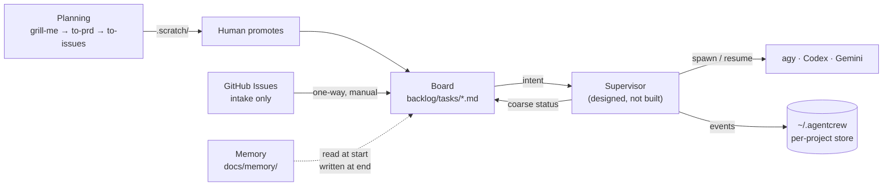

# agentcrew — Project Memory

Long-term memory. Loaded at the start of every session. Kept distilled — if it
grows past ~200 lines, move detail into `backlog decision` entries.

## What this is

`agentcrew setup <path>` turns any git repo into one an agent can work
autonomously: a task board, a memory layer, and a planning loop. It is a
**reusable installer** — run once per repo, and `agentcrew update` re-applies
improvements across every repo registered in `~/.agentcrew/state.json`.

The October 2026 design expands this into a **local AI Team Workspace**:
one operator, one repo, one iteration; persistent BA/PO/architect/developer/
tester/integrator identities, provider-backed conversations, controlled
handoffs, and a dashboard suite. The installer remains. None of the team
supervisor, provider plugins, worktrees, or dashboards is built yet.

Read [the PRD](../PRD.md) for scope/behavior and [the TRD](../TRD.md) for
proposed architecture/contracts before implementing platform work. The TRD
separates engineering defaults from verified provider capabilities.



## The selection criterion (this is the load-bearing one)

The platform must require **no agentcrew account or hosted control plane**;
its durable knowledge stays in owned formats. Provider inference and GitHub/CI
have their own network/account requirements. Frontend build tooling and
maintained dependencies are allowed under the October design; local data must
remain useful if a maintainer disappears.

Backlog.md keeps tasks as Markdown even if the tool is abandoned. That data
ownership requirement survives the move to a richer web application.

## Load-bearing decisions

1. **Backlog.md owns execution; GitHub issues are intake only.** Promotion is
   one-way and manual, and nothing syncs back. Two systems that both claim to
   know "what's being worked on" will eventually disagree.
2. **Memory is markdown, not a service.** Split by *retention*, not topic, all
   under `docs/memory/`. Modelled on OpenClaw's design. Cline's Memory Bank
   splits by topic and reads everything every session, deliberately not copied,
   because that gets more expensive as a project grows.
3. **ADRs are Backlog.md's `decision` command**, not a hand-rolled
   `docs/decisions/`. It ships one, indexed by `backlog search`.
4. **Agent-agnostic is a hard requirement, not a preference.** The maintainer
   uses Claude + Kimi personally and *only* Gemini on a corporate machine.
   Anything that hardcodes one agent is disqualified, which is why enforcement
   lives in markdown instructions rather than Claude Code hooks.
   *Corrected 2026-09-19 (decision-3):* the constraint is **which CLI is
   permitted and present**, not install rights. Nothing needs admin;
   `npm config set prefix ~/.local` covers the global install. The real
   blockers on a locked-down machine are no Node, a TLS-intercepting proxy,
   account policy, endpoint protection killing daemons, and port binding.
5. **Validate before designing.** The previous iteration designed an entire
   wizard around Vibe Kanban and guild without running either. Backlog.md was
   spiked against a real install *before* any code was written against it,
   which immediately caught that `--json` doesn't exist (it's `--plain`).
6. **AGENTS.md is the only rules file.** `CLAUDE.md` and `GEMINI.md` are
   one-line `@AGENTS.md` redirects, not copies. Both CLIs expand `@file`, so
   the redirect is an import. `mergeAgentsMd` folds hand-written rules out of
   the redirected files into `AGENTS.md` before overwriting them.
7. **Short-term memory is archived, never deleted.** Old day sections move to
   `docs/memory/archived/session_YYYY_MM_DD.md` and are linked from the archive
   index. Git would keep deleted logs, but nothing would ever look there.
   Enforcement is markdown policy in `templates/AGENTS.snippet.md`, per
   decision 4.
8. **PRD owns product requirements; TRD owns proposed implementation design.**
   `PRODUCT.md` is the entry point and preserves old numbered anchors.
   Accepted ADRs govern architecture; explicit supersessions qualify older
   decisions. Historical provider/terms claims are not current evidence.
9. **October defaults:** 13 identities (1 BA, 1 PO, 1 architect, 4 devs,
   4 testers, 2 integrators); 4 active turns. Delegation stays in the roster.
   Human approves plan/scope changes; merges and memory approval configurable.
   Browser takeover permits human-directed tools, suppresses autonomous input.
10. **Scope changes are popup tickets.** Preserve the iteration baseline;
    show reusable/discarded work, estimated/actual impact, revised commitment.
    Integrated acceptance, not conversation completion, proves delivery.

| ADR | Says |
|---|---|
| decision-1 | adopt Hermes as orchestrator — **superseded** by decision-3 |
| decision-2 | never proxy vendor credentials; drive the official binaries |
| decision-3 | agentcrew *is* the orchestrator; takeover is the forcing need |
| decision-4 | intent in markdown, events in a store outside the repo |
| decision-5 | interrupts in-band first; signals are a per-OS runtime concern |
| decision-6 | mocked CLIs and no vendor credentials in CI; older provider/dependency assumptions superseded |
| decision-7 | accepted team-workspace direction and explicit legacy supersessions |
| decision-8 | proposed technical baseline; provider verification still required |

## Verified facts

Original behavior was spiked against Backlog.md **v1.48.0**. During the
2026-10-11 docs task, a temporary **v1.52.0** install verified task/decision
creation help; re-spike runtime bridge operations before implementation.
The CLI was absent from PATH; temporary tooling lives under `/tmp`, not the
project dependency manifest.

- Install: `npm install -g backlog.md`. 2 packages, ~3s. Cross-platform.
- `backlog init` is non-interactive with
  `--agent-instructions claude,agents,gemini --integration-mode cli`, and
  writes all three agent files. `--integration-mode none` writes none, which
  is how agentcrew's own board was initialised.
- It manages its own `<!-- BACKLOG.MD GUIDELINES START -->` block with a
  version stamp and upgrades in place. Our `<!-- agentcrew:start -->` block
  coexists with it.
- Tasks are `backlog/tasks/task-N - Title.md`, YAML frontmatter plus marker
  sections. **A status change rewrites one frontmatter line and bumps
  `updated_date`; the file is not moved or renamed.** That is the event the
  daemon watches.
- Statuses are configurable. `Needs Attention` is added by the wizard.
- Machine-readable output is `--plain`. **There is no `--json`.**
- `backlog decision create` takes only a title and status; bodies are written
  to the file afterwards, since there is no `decision edit`.
- MCP server: `backlog mcp start`, stdio transport, real JSON-RPC.
- Backlog.md forbids editing its files directly, so: **watch the files, write
  through the CLI.**

## The daemon

`agentcrew daemon <path>` watches `backlog/tasks/*.md` and reacts to status
transitions.

- `fs.watch` for latency plus a 30s sweep for correctness, because `fs.watch`
  is unreliable on network mounts and some container filesystems. Changes are
  debounced 250ms.
- Baseline is read from disk at startup rather than persisted, so a restart
  never replays old transitions. Transitions while it is stopped are missed by
  design.
- **Current consolidation writes `docs/memory/MEMORY.proposed.md`, never
  `MEMORY.md`.** The future platform retains human review by default and
  allows explicitly configured automatic application with archived versions.
  Diagnostic proposals changing governing rules always require human approval.

Decision-3 gives the daemon a second half, the session supervisor, which
*does* hold state: a per-project SQLite store outside the repo (decision-4).
The old rule survives in spirit — intent still lives in the repo, so stopping
the daemon loses automation and event history, never tasks.

## Not yet done

- **AI Team Workspace:** detailed in PRD/TRD. The older Supervisor v1 tasks
  (task-1..10) remain planning history and need reconciliation before use.
- **Provider qualification:** agy, Codex, Gemini all required for release.
  CLI help/output streaming does not prove interactive input, permissions,
  interruption, resume, or roster-only delegation enforcement. Each is a
  blocking spike; do not assume Claude-compatible flags or minted native IDs.
- **Worktrees/GitHub:** task isolation, exact-commit reviews, both integration
  strategies, default human merges. No application changes were made by docs.
- **Dashboards:** Kanban, pixel-art room, observability; metrics/diagnostics
  use evidence. Learned historical estimation is deferred.
- **Testing:** no suite/CI exists yet. Required Windows/Linux jobs use fake
  providers and sanitized fixtures; real provider checks remain local.
- **Current daemon does not auto-commit or open PRs.** Future supervised work
  has explicit commit/PR/merge policies; do not attribute them to today's code.
- `/setup-matt-pocock-skills` and initial project-memory authoring remain
  judgment-driven manual steps in the existing installer.

## Memory layout (since 0.5.0)

```text
docs/memory/
  MEMORY.md              long-term, distilled, always loaded, ~200 lines
  MEMORY_SHORTTERM.md    archive index + active `## YYYY-MM-DD` sections
  MEMORY.proposed.md     consolidation output; a human accepts it
  archived/
    session_YYYY_MM_DD.md   retired sections, whole and untouched
```

`agentcrew setup` migrates the pre-0.5 layout on re-run, and nothing is
deleted.

## Repo map

| Path | Role |
|---|---|
| `PRODUCT.md` | spec entry point; preserved legacy task section anchors |
| `docs/PRD.md` | agreed product requirements, stories, and acceptance |
| `docs/TRD.md` | proposed technical design and verification gates |
| `docs/archive/` | preserved historical specification, not active guidance |
| `backlog/decisions/` | agentcrew's own ADRs; the repo dogfoods its board |
| `backlog/tasks/` | agentcrew's own board; `Supervisor v1` is task-1..10 |
| `bin/wizard.js` | CLI entry: `setup <path>`, `update`, `daemon` |
| `src/lib/` | shell helpers, state registry (`~/.agentcrew/state.json`) |
| `src/lib/memory.js` | memory paths, day-section parsing, archive index |
| `src/steps/` | one file per setup step, run in order by the wizard |
| `src/steps/mergeAgentsMd.js` | writes AGENTS.md; redirects CLAUDE.md and GEMINI.md |
| `src/daemon/` | board watcher, journal, consolidation, agent invocation |
| `templates/` | the AGENTS block and memory files injected into onboarded repos |
